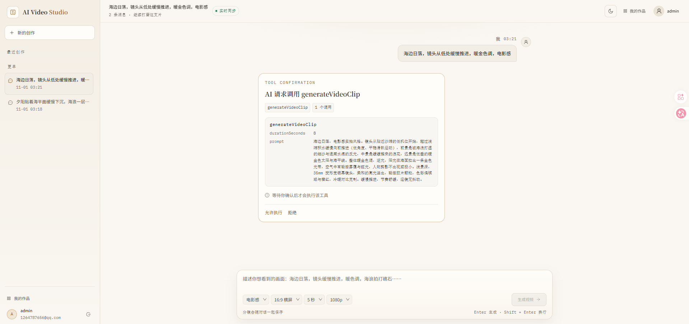
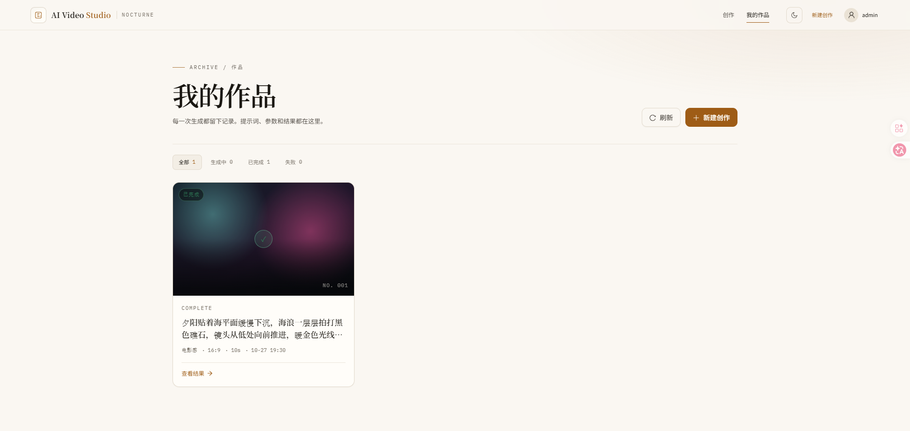
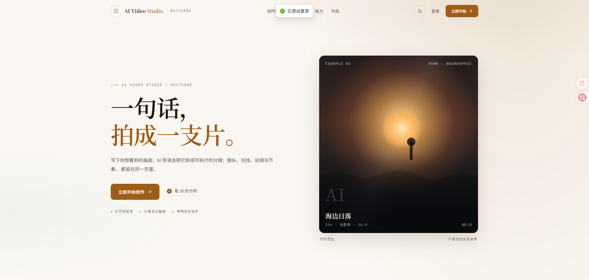

# 基于AgentScope 实现AI Video Studio （功能陆续完善中）

面向 PC 端的 AI 视频创作工具骨架。以「对话 → 分镜 → 视频任务」为主线，前后端分离，当前阶段聚焦工程结构、认证闭环、对话闭环与视频任务占位流程。

> 本仓库是**可运行的最小闭环骨架**：用户注册/登录、会话与消息持久化、Mock / DeepSeek 可切换的对话、WebSocket 模拟流式输出、视频任务状态模拟均已打通；真实视频生成尚未接入。

## 技术栈

| 层 | 技术 |
| --- | --- |
| 前端 | React 18、TypeScript、Vite 5、Ant Design 5、Zustand、React Router 6、Axios |
| 后端 | Java 21、Spring Boot 3.3、Spring Security、Spring WebSocket、MyBatis-Plus、SpringDoc |
| 存储 | MySQL 8、Redis 7、MinIO（接口预留） |
| AI | AgentScope Java 2.0（`ReActAgent` + `Toolkit`），默认 Mock，可切换 DeepSeek（OpenAI 兼容） |
| 认证 | JWT access token + refresh token（刷新旋转、Redis 白名单/黑名单） |

## 目录结构

```text
ai-video/
├── README.md
├── docker-compose.yml            # MySQL / Redis / MinIO 本地依赖
├── docs/
│   ├── architecture.md           # 架构与核心流程
│   ├── api-convention.md         # 接口规范与接口清单
│   └── dev-guide.md              # 开发、环境变量与 Git 规范
├── frontend/                     # React + Vite
│   ├── src/
│   │   ├── api/                  # Axios 封装与接口
│   │   ├── components/           # 通用与对话组件
│   │   ├── hooks/                # useChatSocket
│   │   ├── layouts/              # AppLayout
│   │   ├── pages/                # Login / Register / Chat / Project
│   │   ├── router/               # 路由与守卫
│   │   ├── stores/               # Zustand auth / chat
│   │   ├── types/                # 前端类型定义
│   │   └── utils/                # token 存储、WebSocket、错误处理
│   ├── .env.example
│   └── package.json
└── backend/                      # Spring Boot 单模块 Maven
    ├── src/main/java/com/aivideo/
    │   ├── auth/                 # 注册、登录、刷新、登出
    │   ├── agent/                # AgentScope 封装、MockProvider、工具
    │   ├── chat/                 # 会话与消息
    │   ├── common/               # Result、异常、分页
    │   ├── config/               # Security、WebSocket、AgentScope 等
    │   ├── project/              # 创作项目
    │   ├── security/             # JWT、TokenStore、过滤器
    │   ├── storage/              # 对象存储抽象（占位）
    │   ├── user/                 # 用户实体与查询
    │   ├── video/                # 视频任务（占位实现）
    │   └── websocket/            # 握手、会话注册表、推送
    ├── src/main/resources/
    │   ├── application.yml
    │   ├── application-dev.yml   # H2 + 内存 TokenStore
    │   └── db/schema.sql         # MySQL 初始化脚本
    ├── .env.example
    └── pom.xml
```

## 环境要求

| 工具 | 版本 |
| --- | --- |
| Node.js | 20+ |
| npm | 10+ |
| JDK | 21 |
| Maven | 3.9+ |
| Docker（可选） | 24+，用于 MySQL / Redis / MinIO |

> 默认 `JAVA_HOME` 必须指向 JDK 21；仅装了 JDK 17 时 Maven 编译会失败。

## 快速启动

### 1. 启动依赖服务（推荐）

```bash
docker compose up -d
```

首次创建 MySQL 数据卷时会自动执行 `backend/src/main/resources/db/schema.sql`。若数据卷已存在或表未创建，可手动导入：

```powershell
Get-Content .\backend\src\main\resources\db\schema.sql -Raw |
  docker exec -i aivideo-mysql mysql -uroot -proot123456 ai_video
```

### 2. 启动后端

```powershell
cd backend
$env:JAVA_HOME = "C:\path\to\jdk-21"
mvn spring-boot:run
```

默认读取 MySQL（`localhost:3306/ai_video`，账号 `aivideo / aivideo123`）与 Redis（`localhost:6379`），数据源使用 Druid 连接池。配置优先从环境变量读取，也自动加载 `backend/.env`（不存在则忽略）；模板见 [`backend/.env.example`](backend/.env.example)。启动完成后会打印实际生效的 MySQL / Redis 配置（密码隐藏）并 PING Redis。

**连接外部 MySQL**：优先设置完整 `DB_URL`（可带 SSL 参数），再设置 `DB_USERNAME` / `DB_PASSWORD`；首次建表可临时设置 `DB_INIT_MODE=always`。池大小用 `DB_POOL_MAX_ACTIVE` 等变量调整，详见 [`docs/dev-guide.md`](docs/dev-guide.md#211-连接外部-mysql)。

**无 Docker 的本地体验**：使用 `dev` profile，内置 H2（MySQL 兼容模式）与内存版 TokenStore，不需要 MySQL / Redis：

```powershell
mvn spring-boot:run "-Dspring-boot.run.profiles=dev"
```

### 3. 启动前端

```bash
cd frontend
npm install
npm run dev
```

访问 <http://localhost:5173>。未配置 `.env` 时，Vite 会把 `/api` 与 `/ws` 代理到 `http://localhost:8080`；如需直连后端：

```bash
cp .env.example .env
```

### 4. 打开接口文档

- Swagger UI：<http://localhost:8080/swagger-ui.html>
- OpenAPI JSON：<http://localhost:8080/v3/api-docs>

## 默认端口

| 服务 | 端口 |
| --- | --- |
| 前端 Vite | 5173 |
| 后端 Spring Boot | 8080 |
| MySQL | 3306 |
| Redis | 6379 |
| MinIO API / Console | 9000 / 9001 |

## 环境变量

### 后端（`backend/.env.example`）

| 变量 | 说明 | 默认值（仅开发） |
| --- | --- | --- |
| `SERVER_PORT` | 后端端口 | `8080` |
| `SPRING_PROFILES_ACTIVE` | `dev` 时使用 H2 + 内存 TokenStore | 空 |
| `DB_URL` | 完整 JDBC 串（外部数据库优先） | 由 `DB_HOST` 等拼装 |
| `DB_HOST` / `DB_PORT` / `DB_NAME` | MySQL 连接 | `localhost` / `3306` / `ai_video` |
| `DB_USERNAME` / `DB_PASSWORD` | MySQL 账号 | `aivideo` / `aivideo123` |
| `DB_INIT_MODE` | 是否执行 `db/schema.sql` | `never` |
| `DB_POOL_INITIAL_SIZE` / `DB_POOL_MIN_IDLE` / `DB_POOL_MAX_ACTIVE` / `DB_POOL_MAX_WAIT` | Druid 池参数 | `5` / `5` / `20` / `60000` |
| `REDIS_HOST` / `REDIS_PORT` / `REDIS_PASSWORD` | Redis 连接 | `localhost` / `6379` / 空 |
| `TOKEN_STORE` | `redis` 或 `memory` | `redis` |
| `JWT_SECRET` | JWT 签名密钥，**生产必须替换** | 开发占位密钥 |
| `JWT_ACCESS_TTL` / `JWT_REFRESH_TTL` | ISO-8601 有效期 | `PT30M` / `P7D` |
| `STORAGE_PROVIDER` | 对象存储实现 | `minio` |
| `MINIO_ENDPOINT` / `MINIO_ACCESS_KEY` / `MINIO_SECRET_KEY` / `MINIO_BUCKET` | MinIO 配置 | `http://localhost:9000` / `minioadmin` / `minioadmin` / `aivideo` |
| `AGENTSCOPE_ENABLED` | 是否启用真实 Agent | `false` |
| `AGENTSCOPE_MODEL` | AgentScope 模型标识（需 `deepseek:` 前缀） | `deepseek:deepseek-v4-flash` |
| `DEEPSEEK_API_KEY` | 启用真实模型时必填 | 无 |
| `DEEPSEEK_BASE_URL` | DeepSeek / 兼容网关地址 | `https://api.deepseek.com` |
| `AGENTSCOPE_TIMEOUT` | 单次模型调用超时（需小于前端 20s） | `PT15S` |
| `AGENTSCOPE_MAX_ITERS` / `AGENTSCOPE_MAX_ATTEMPTS` | ReAct 迭代上限 / 模型调用尝试次数 | `3` / `1` |

### 前端（`frontend/.env.example`）

| 变量 | 说明 | 默认 |
| --- | --- | --- |
| `VITE_API_BASE_URL` | REST 基础地址 | `/api/v1`（走 Vite 代理） |
| `VITE_WS_URL` | WebSocket 地址 | 由当前页面推导 `/ws/chat` |

## 已实现功能

- **用户闭环**：注册（BCrypt 加密）、登录（用户名或邮箱）、刷新 token、登出、`/auth/me`；前端表单校验与错误提示。
- **对话闭环**：创建会话、会话分页、历史消息分页、发送消息；消息持久化到 MySQL；默认 Mock Agent 不发起网络请求，设置 `AGENTSCOPE_ENABLED=true` + `DEEPSEEK_API_KEY` 后切换真实 DeepSeek。
- **实时输出**：原生 WebSocket `/ws/chat?token=...`，后端按 6 字符/40ms 推送 `chat.chunk`，结束发送 `chat.done`；前端带 5 秒同步兜底。
- **视频任务**：`POST /video/tasks` 创建任务、查询详情/分页列表；异步模拟 `PENDING → RUNNING 30% → RUNNING 70% → SUCCESS 100%`。
- **工程能力**：统一 `Result<T>` / 错误码 / 全局异常处理、参数校验、Swagger 注解、CORS、逻辑删除、统一分页、对象存储扩展点。

## 当前占位与 TODO

- [x] 接入真实大模型：已按最小可用方案接入 DeepSeek（`agentscope-extensions-model-openai` + `deepseek:` provider）。
- [ ] 模型体验增强：token 级真流式、从 AgentScope 工具调用事件提取真实意图（当前仍为关键词识别与完整回复切片）。
- [ ] 接入真实视频生成服务（如可灵、即梦、Runway 等），替换 `VideoGenerationServiceImpl` 中的模拟状态机。
- [ ] 使用 Redis / MQ 承载视频任务队列，支持重试、超时、取消与回调。
- [ ] MinIO 实际写入与预签名 URL（`MinioObjectStorageService` 目前仅保留接口）。
- [ ] 将视频任务与项目、分镜数据关联，支持从聊天结果一键生成项目。
- [ ] 验证码、限流、登录失败锁定等安全增强。
- [ ] 单元测试、集成测试与 CI 流水线。
- [ ] 生产部署配置（HTTPS、真实 Redis、外部化 JWT 密钥、日志与监控）。

更多设计说明见 [`docs/architecture.md`](docs/architecture.md)，接口清单见 [`docs/api-convention.md`](docs/api-convention.md)，开发约定见 [`docs/dev-guide.md`](docs/dev-guide.md)。

## 免责声明

仓库内所有视频结果 URL 均为 `https://example.com/...` 占位地址，不包含真实生成内容。

### 展示截图



