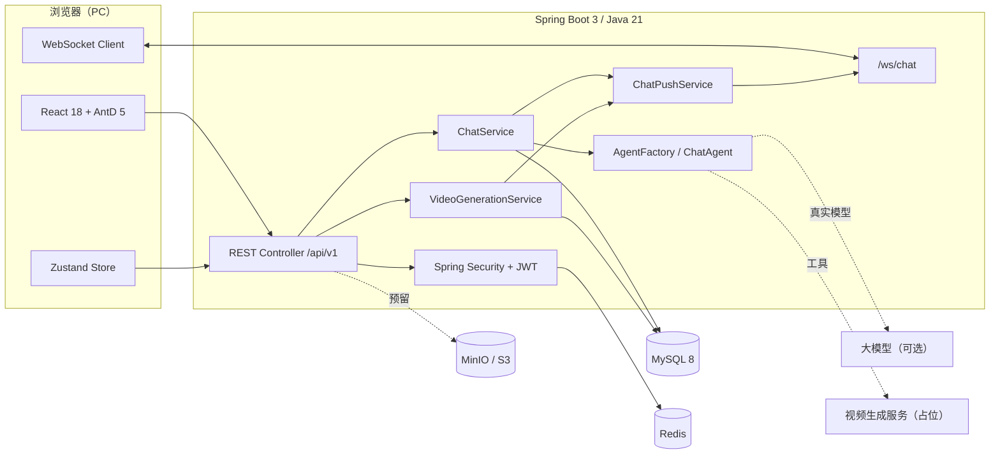
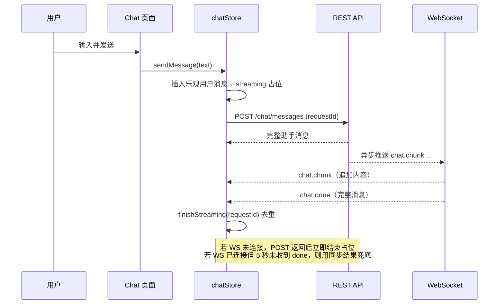
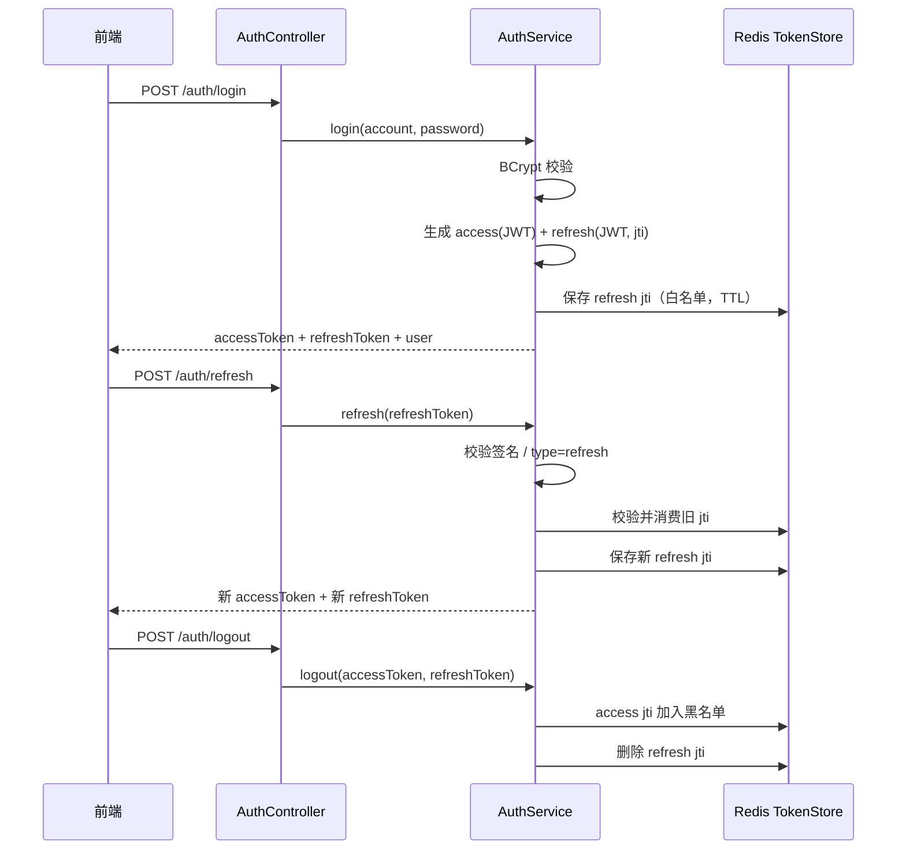
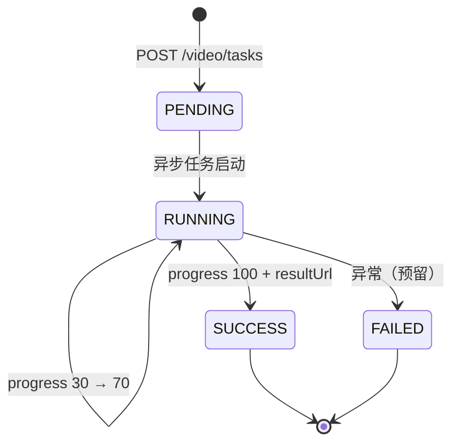

# 架构设计

## 1. 总览

AI Video Studio 采用前后端分离的单仓库结构：



设计原则：

- **接口先于实现**：真实模型、视频生成、对象存储都通过接口隔离，骨架阶段提供 Mock / 占位实现。
- **单一职责**：Controller 只做参数接收与响应包装，业务在 Service，Agent 调用通过工厂间接完成。
- **可替换**：`TokenStore`、`ModelProvider`、`VideoGenerationService`、`ObjectStorageService` 都是可替换实现。
- **安全默认**：所有业务接口需要 Bearer token，敏感配置来自环境变量。

## 2. 前端架构

```text
src/
├── api/           request.ts + auth/ chat/ project/ video/ 模块接口
├── components/    common/Brand / auth/AuthForm·AuthModal / create/* / works/WorkCard
├── hooks/         useChatSocket
├── layouts/       RootLayout（全局 AuthModal）/ WorksLayout（作品区顶栏）
├── pages/         Landing / Create / Works / Login / Register / NotFound
├── router/        路由表 + ProtectedRoute
├── stores/        authStore / chatStore / draftStore / authGate（Zustand）
├── types/         common/ auth/ chat/ video/ project/ 模块类型
└── utils/         tokenStorage / error
```

### 2.1 状态与数据流

- `tokenStorage` 是 access / refresh token 的唯一来源，存于 `localStorage`。
- `authStore` 只持久化用户信息；登录/注册成功后写入 token，`logout` 调用后端后清理 token。
- `chatStore` 管理会话列表、当前会话、消息、流式占位、WebSocket 状态。
- 发送消息时：



### 2.2 路由与鉴权

| 路径 | 组件 | 说明 |
| --- | --- | --- |
| `/` | LandingPage | 公开门户；已登录时重定向 `/create` |
| `/create` | CreatePage | 公开创作工作台；游客可输入，生成时登录 |
| `/works` | WorksPage | 受保护；位于 `ProtectedRoute` + `WorksLayout` 下 |
| `/login` | LoginPage | 兜底登录页；已登录时重定向 `/create` |
| `/register` | RegisterPage | 兜底注册页；已登录时重定向 `/create` |
| `/chat` | Redirect | 兼容旧链接，重定向 `/create` |
| `/project` | Redirect | 兼容旧链接，重定向 `/works` |
| `*` | NotFoundPage | 404 |

`RootLayout` 包住全部路由并渲染全局 `AuthModal`，保证弹窗内的 `<Link>` 和登录后的挂起动作处于 Router 上下文。

`ProtectedRoute` 只检查 `tokenStorage` 中是否有 access token；缺失时重定向 `/create?auth=works`，由 `CreatePage` 打开对应文案的登录弹窗。

### 2.2.1 游客草稿与认证门禁

- 游客可以访问 `/` 与 `/create`，输入提示词、切换风格/比例/时长/分辨率，但不会连接 WebSocket，也不会请求 `/chat/sessions`。
- 草稿写入 `sessionStorage` 的 `aivideo.create.draft`，带 24 小时 TTL；关闭弹窗、切换页面都不清空。
- 点击「生成视频」、作品入口或登录时，`authGate` 记录 `reason`、当前草稿和挂起动作，并打开 `AuthModal`。
- 登录或注册成功后 `completeGate` 执行挂起动作：生成流程会继续发送消息并创建视频任务，作品入口进入 `/works`。
- 接口返回 401 且刷新失败时，清理 token 并跳到 `/create?auth=expired`，保留草稿并重新打开登录弹窗。
- 会话消息与视频任务没有持久化关联字段，生成卡只保存在当前页面状态；刷新后可从 `/video/tasks` 恢复作品列表。

### 2.3 Axios 拦截器

- 请求：自动附加 `Authorization: Bearer <accessToken>`。
- 响应：后端 `code !== 0` 时抛出 `ApiError`。
- 401：使用 `refreshToken` 单飞刷新；刷新期间并发的 401 共用同一个 Promise；刷新成功后重放原请求。
- 刷新失败：清空 token，提示登录已过期；非 `/login`、`/register` 页面跳转 `/create?auth=expired`（来自 `/works` 时为 `?auth=works`）。

### 2.4 WebSocket

- 地址：`VITE_WS_URL` 或按当前页面推导；默认 `/ws/chat`。
- 握手：`/ws/chat?token=<accessToken>`。
- 25 秒发送一次 `ping`，断线后指数退避重连，最多 6 次。
- 事件按 `type` 分发；`requestId` 用于将分片关联到具体一次发送。
- 游客不建立 WebSocket；`useChatSocket(enabled)` 在未登录时直接返回并保持「离线兜底」状态。

## 3. 后端架构

### 3.1 包结构

```text
com.aivideo
├── common         Result / PageResult / ResultCode / BizException / 全局异常
├── config         Security / WebSocket / AgentScope / Druid 数据源 / StartupInfoRunner / MyBatis-Plus / CORS 等
├── security       JwtTokenProvider / TokenStore / JwtAuthenticationFilter / UserPrincipal
├── user           用户实体、Mapper、Service
├── auth           注册登录、Token DTO、AuthController
├── chat           会话、消息、ChatService、ChatController
├── agent          ChatAgent / ModelProvider / AgentScope 封装 / 工具
├── project        创作项目 CRUD
├── video          视频任务、VideoGenerationService（占位）
├── storage        ObjectStorageService（MinIO 占位）
└── websocket      握手拦截、连接注册表、推送服务
```

业务包内部遵循 `controller / service / service.impl / dto / entity / mapper` 分层。

### 3.2 认证设计



- access token：`sub` 为用户 ID，包含 `username`、`type=access`、`jti`，默认 30 分钟。
- refresh token：`type=refresh`，默认 7 天；刷新时旋转，旧 refresh 立即失效。
- `TokenStore` 有两种实现：
  - `RedisTokenStore`（默认）：refresh 白名单 + access 黑名单，支持多实例。
  - `InMemoryTokenStore`：`app.token-store=memory` 时启用，仅用于无 Redis 的本地演示。
- `JwtAuthenticationFilter` 解析 Bearer token，校验类型与黑名单后写入 `SecurityContext`。
- 密码使用 `BCryptPasswordEncoder`，数据库中不保存明文。
- 公开路径仅限注册、登录、刷新、WebSocket 握手、Swagger 与 `/error`。

### 3.3 对话设计

`ChatService.sendMessage` 的核心步骤：

1. 校验会话归属（会话必须属于当前用户）。
2. 加载最近 `app.agentscope.max-history-messages` 条历史消息。
3. 保存用户消息。
4. 通过 `AgentFactory.getAgent().chat(AgentRequest)` 获取 `AgentReply`。
5. 保存助手消息（`role=ASSISTANT`，可带 `videoIntent` / `toolName`）。
6. 更新会话 `lastMessageAt`；首条消息时用前 30 个字符生成标题。
7. 通过 `ChatPushService` 异步推送模拟分片，同时同步返回完整消息。

Agent 层解耦：

```text
ChatService
   └── AgentFactory
         └── ChatAgent（唯一实现）
               ├── ProviderChatAgent → MockModelProvider（默认，无网络）
               └── AgentScopeChatAgent → ReActAgent + Toolkit（AGENTSCOPE_ENABLED=true）
```

- 版本假设：当前基于 `io.agentscope:agentscope-core:2.0.2` 编译验证（Java 17+）；升级 AgentScope 时需复核 `ReActAgent` / `Toolkit` 的 API 签名。
- `VideoAssistantAgent` 的人格与模型由 `AgentScopeConfig` 创建，系统提示词可通过 `app.agentscope.sys-prompt` 调整。
- 已注册两个占位工具：
  - `generateStoryboard`：生成分镜占位结果。
  - `generateVideoClip`：生成视频片段占位结果。
- 默认 Mock 模式通过关键词识别意图（分镜 / 视频 / 镜头），仅用于演示；接入真实模型后应从 AgentScope 的工具调用事件中提取。

### 3.4 WebSocket 协议

端点：`ws://localhost:8080/ws/chat?token=<accessToken>`

服务端消息统一为：

```json
{
  "type": "chat.chunk",
  "data": {
    "sessionId": 12,
    "requestId": "c1f5…",
    "delta": "（Mock 模"
  }
}
```

| type | 触发时机 | data 字段 |
| --- | --- | --- |
| `chat.chunk` | 助手回复流式分片 | `sessionId`、`requestId`、`delta` |
| `chat.done` | 一次回复结束 | `sessionId`、`requestId`、`message`（完整 `ChatMessageResponse`） |
| `video.progress` | 视频任务状态变化 | `taskId`、`status`、`progress`、`resultUrl` |
| `pong` | 客户端发送 `ping` 后 | 无 |

握手时解析 query 中的 token，校验 access 类型与黑名单，并将 `userId` / `username` 写入会话属性。每个用户可同时存在多个连接，推送时逐个发送并对 session 加锁。

### 3.5 视频任务



- 创建任务时校验 `projectId` 归属，写入 `video_tasks`。
- `videoTaskExecutor` 异步推进状态，并通过 WebSocket 推送 `video.progress`。
- 当前结果 URL 固定为 `https://example.com/mock-video/{id}.mp4`。
- 真实接入时替换 `VideoGenerationServiceImpl`，建议改为「提交厂商任务 → 入库外部任务 ID → 回调/轮询 → 更新状态」的持久化流程。

### 3.6 项目与对象存储

- `Project` 保存名称、描述、剧本、分镜 JSON 字符串，当前由 REST CRUD 管理，前端尚未接入完整项目页。
- `ObjectStorageService` 定义 `upload` / `presign` 能力；`MinioObjectStorageService` 为占位实现，不实际写入。
- 后续可把对话生成的分镜保存到 `storyboard`，视频任务通过 `projectId` 关联。

## 4. 数据模型

| 表 | 关键字段 | 说明 |
| --- | --- | --- |
| `users` | `username`、`email`、`password_hash`、`nickname`、`avatar_url`、`status` | 用户名与邮箱唯一 |
| `chat_sessions` | `user_id`、`title`、`last_message_at` | 会话归属用户 |
| `chat_messages` | `session_id`、`role`、`content`、`message_type`、`metadata` | `metadata` 保存 `videoIntent` / `toolName` |
| `projects` | `user_id`、`name`、`description`、`script`、`storyboard` | 分镜暂存为 JSON 字符串 |
| `video_tasks` | `user_id`、`project_id`、`prompt`、`params`、`status`、`progress`、`result_url` | 参数为 JSON 字符串 |

所有表包含 `created_at`、`updated_at`、`deleted`（MyBatis-Plus 逻辑删除）。主键使用数据库自增，避免雪花 ID 在 JavaScript 中丢失精度。

## 5. 关键设计决策

| 决策 | 原因 |
| --- | --- |
| 自增主键而非雪花 ID | 前端 `number` 精度安全，骨架阶段足够 |
| 同步返回 + WebSocket 推流 | 即使实时连接不可用，也能保证消息最终展示 |
| `requestId` 关联 | 解决 WS 分片、done 与 POST 响应之间的竞态 |
| access + refresh 双 token | 缩短 access 生命周期，支持 refresh 旋转与主动登出 |
| Agent 通过工厂获取 | ChatService 不依赖具体模型实现，便于切换 Mock / AgentScope |
| dev profile 使用 H2 | 无 Docker 环境也能完成本地烟测，降低启动门槛 |
| 接口先定义、实现占位 | 符合骨架阶段目标，后续替换不影响上层 |

## 6. 已知边界

- WebSocket 模拟流式输出是**发送完整消息后切片推送**，不是模型 token 级流式。
- Mock 意图识别基于关键词，真实工具调用结果尚未回传。
- 视频任务状态在内存异步线程中推进；应用重启后未完成任务不会自动恢复。
- 刷新 token 的白名单依赖 Redis；`memory` 模式不支持多实例。
- 未实现验证码、限流、登录失败锁定、文件上传与前端项目管理页面。
