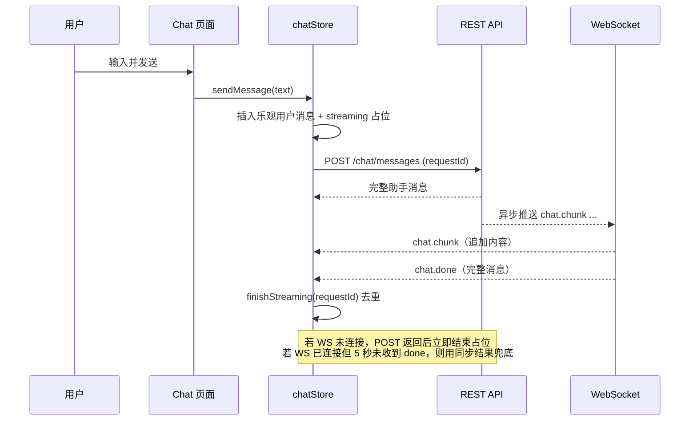
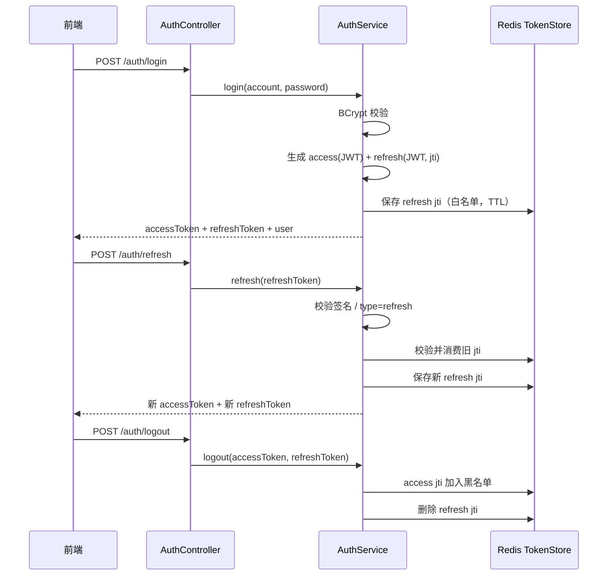
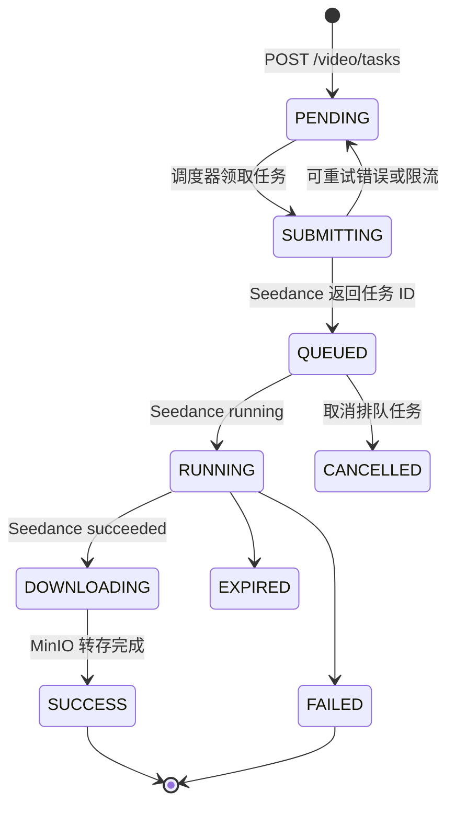

# 架构设计

## 1. 总览

AI Video Studio 采用前后端分离的单仓库结构：

```mermaid
flowchart LR
    subgraph Browser["浏览器（PC）"]
        UI["React 18 + AntD 5"]
        Store["Zustand Store"]
        WSClient["WebSocket Client"]
    end

    subgraph Backend["Spring Boot 3 / Java 21"]
        API["REST Controller /api/v1"]
        Auth["Spring Security + JWT"]
        Chat["ChatService"]
        Agent["AgentFactory / ChatAgent"]
        Video["VideoGenerationService"]
        Push["ChatPushService"]
        WS["/ws/chat"]
    end

    DB[("MySQL 8")]
    Redis[("Redis")]
    MinIO[("MinIO / S3")]
    LLM["大模型（可选）"]
    VideoProvider["Seedance / Mock 视频服务"]

    UI --> API
    Store --> API
    WSClient <--> WS
    API --> Auth
    API --> Chat
    API --> Video
    Chat --> Agent
    Chat --> DB
    Chat --> Push
    Push --> WS
    Video --> DB
    Video --> Push
    Auth --> Redis
    Agent -. 真实模型 .-> LLM
    Agent -. 工具 .-> VideoProvider
    API -. 预留 .-> MinIO
```



设计原则：

- **接口先于实现**：模型、视频服务、对象存储都通过接口隔离，支持 Mock 与真实实现切换。
- **单一职责**：Controller 只做参数接收与响应包装，业务在 Service，Agent 调用通过工厂间接完成。
- **可替换**：`TokenStore`、`ModelProvider`、`VideoGenerationService`、`ObjectStorageService` 都是可替换实现。
- **安全默认**：所有业务接口需要 Bearer token，敏感配置来自环境变量。

## 2. 前端架构

```text
src/
├── api/           request.ts + auth/ chat/ project/ video/ 模块接口
├── components/    common/Brand / auth/AuthForm·AuthModal / create/* / works/WorkCard
├── hooks/         useChatSocket
├── layouts/       RootLayout（全局 AuthModal）/ WorksLayout（作品区顶栏）
├── pages/         Landing / Create / Works / Login / Register / NotFound
├── router/        路由表 + ProtectedRoute
├── stores/        authStore / chatStore / draftStore / authGate（Zustand）
├── types/         common/ auth/ chat/ video/ project/ 模块类型
└── utils/         tokenStorage / error
```

### 2.1 状态与数据流

- `tokenStorage` 是 access / refresh token 的唯一来源，存于 `localStorage`。
- `authStore` 只持久化用户信息；登录/注册成功后写入 token，`logout` 调用后端后清理 token。
- `chatStore` 管理会话列表、当前会话、消息、流式占位、实时推理轨迹与 WebSocket 状态。
- 发送消息时：



真实模式下，Agent 事件会先经 `AgentProgressTranslator` 翻译，再由 `ChatPushService` 以 `chat.progress` 同步推送；前端写入 `liveTrace`，在消息流中实时渲染「推理过程」卡片，`chat.done` 或失败后清理，最终消息以 `reasoningSteps` 持久化展示。

### 2.2 路由与鉴权

| 路径 | 组件 | 说明 |
| --- | --- | --- |
| `/` | LandingPage | 公开门户；已登录时重定向 `/create` |
| `/create` | CreatePage | 公开创作工作台；游客可输入，生成时登录 |
| `/works` | WorksPage | 受保护；位于 `ProtectedRoute` + `WorksLayout` 下 |
| `/login` | LoginPage | 兜底登录页；已登录时重定向 `/create` |
| `/register` | RegisterPage | 兜底注册页；已登录时重定向 `/create` |
| `/chat` | Redirect | 兼容旧链接，重定向 `/create` |
| `/project` | Redirect | 兼容旧链接，重定向 `/works` |
| `*` | NotFoundPage | 404 |

`RootLayout` 包住全部路由并渲染全局 `AuthModal`，保证弹窗内的 `<Link>` 和登录后的挂起动作处于 Router 上下文。

`ProtectedRoute` 只检查 `tokenStorage` 中是否有 access token；缺失时重定向 `/create?auth=works`，由 `CreatePage` 打开对应文案的登录弹窗。

### 2.2.1 游客草稿与认证门禁

- 游客可以访问 `/` 与 `/create`，输入提示词、切换风格/比例/时长/分辨率，但不会连接 WebSocket，也不会请求 `/chat/sessions`。
- 草稿写入 `sessionStorage` 的 `aivideo.create.draft`，带 24 小时 TTL；关闭弹窗、切换页面都不清空。
- 点击「生成视频」、作品入口或登录时，`authGate` 记录 `reason`、当前草稿和挂起动作，并打开 `AuthModal`。
- 登录或注册成功后 `completeGate` 执行挂起动作：生成流程会继续发送消息并创建视频任务，作品入口进入 `/works`。
- 接口返回 401 且刷新失败时，清理 token 并跳到 `/create?auth=expired`，保留草稿并重新打开登录弹窗。
- `PROMPT_PROPOSAL` 和 `VIDEO_CARD` 均持久化在聊天消息中；视频任务通过 `chat_session_id` / `chat_message_id` 关联，刷新可从历史恢复。

### 2.3 Axios 拦截器

- 请求：自动附加 `Authorization: Bearer <accessToken>`。
- 响应：后端 `code !== 0` 时抛出 `ApiError`。
- 401：使用 `refreshToken` 单飞刷新；刷新期间并发的 401 共用同一个 Promise；刷新成功后重放原请求。
- 刷新失败：清空 token，提示登录已过期；非 `/login`、`/register` 页面跳转 `/create?auth=expired`（来自 `/works` 时为 `?auth=works`）。

### 2.4 WebSocket

- 地址：`VITE_WS_URL` 或按当前页面推导；默认 `/ws/chat`。
- 握手：`/ws/chat?token=<accessToken>`。
- 25 秒发送一次 `ping`，断线后指数退避重连，最多 6 次。
- 事件按 `type` 分发；`requestId` 用于将分片关联到具体一次发送。
- `chat.progress` 按 `sessionId + requestId` 双校验写入 `liveTrace`；切会话、工具确认、完成或失败时清空，避免迟到事件串场。
- 游客不建立 WebSocket；`useChatSocket(enabled)` 在未登录时直接返回并保持「离线兜底」状态。

## 3. 后端架构

### 3.1 包结构

```text
com.aivideo
├── common         Result / PageResult / ResultCode / BizException / 全局异常
├── config         Security / WebSocket / AgentScope / Druid 数据源 / StartupInfoRunner / MyBatis-Plus / CORS 等
├── security       JwtTokenProvider / TokenStore / JwtAuthenticationFilter / UserPrincipal
├── user           用户实体、Mapper、Service
├── auth           注册登录、Token DTO、AuthController
├── chat           会话、消息、ChatService、ChatController
├── agent          ChatAgent / ModelProvider / AgentScope 封装 / 工具
├── project        创作项目 CRUD
├── video          Seedance / Mock Provider、任务调度、MinIO 转存与计费快照
├── storage        ObjectStorageService / MinIO
└── websocket      握手拦截、连接注册表、推送服务
```

业务包内部遵循 `controller / service / service.impl / dto / entity / mapper` 分层。

### 3.2 认证设计



- access token：`sub` 为用户 ID，包含 `username`、`type=access`、`jti`，默认 30 分钟。
- refresh token：`type=refresh`，默认 7 天；刷新时旋转，旧 refresh 立即失效。
- `TokenStore` 有两种实现：
  - `RedisTokenStore`（默认）：refresh 白名单 + access 黑名单，支持多实例。
  - `InMemoryTokenStore`：`app.token-store=memory` 时启用，仅用于无 Redis 的本地演示。
- `JwtAuthenticationFilter` 解析 Bearer token，校验类型与黑名单后写入 `SecurityContext`。
- 密码使用 `BCryptPasswordEncoder`，数据库中不保存明文。
- 公开路径仅限注册、登录、刷新、WebSocket 握手、Swagger 与 `/error`。

### 3.3 对话设计

`ChatService.sendMessage` 的核心步骤：

1. 校验会话归属（会话必须属于当前用户）；同一会话存在待确认的工具调用时直接返回 `40900`。
2. 加载最近 `app.agentscope.max-history-messages` 条历史消息（过滤 `TOOL_CONFIRM` 卡片）。
3. 在**事务外**通过 `AgentFactory.getAgent().chat(AgentRequest)` 获取 `AgentOutcome`，避免模型网络调用占用数据库连接。
4. 按结果分支：
   - `Completed`：在同一短事务中保存用户消息、助手消息（`role=ASSISTANT`，可带 `videoIntent` / `toolName`）并更新会话；事务提交后通过 `ChatPushService` 异步推送模拟分片，同时同步返回完整消息。
   - `AwaitingConfirmation`：短事务写入用户消息 + `messageType=TOOL_CONFIRM` 的助手消息（`metadata` 保存 `confirmationId` / `replyId` / `toolCalls` / `confirmStatus=PENDING` / `toolName`），事务外注册挂起记录并推送 `chat.tool_confirm_required`，**不推送** `chat.done`。
5. 更新会话 `lastMessageAt`；首条消息时用前 30 个字符生成标题。

模型调用失败时不写入任何消息，与前端移除乐观消息的行为一致。

工具确认与恢复：

```text
POST /chat/messages/{id}/confirm { approved }
  → getOwnedMessage（跨用户 40400）
  → 校验 messageType=TOOL_CONFIRM 且 confirmStatus=PENDING
  → PendingConfirmationRegistry.claim（原子领取，防重复点击）
  → AgentScopeChatAgent.confirm（同一 RuntimeContext 再次 streamEvents）
  → Completed：更新原卡片状态 + 插入最终助手消息；推送 chat.tool_confirm_result + chat.chunk/chat.done
  → AwaitingConfirmation：更新原卡片 + 插入新的 TOOL_CONFIRM 卡片并再次挂起
```

- 挂起记录保存在 `PendingConfirmationRegistry`（单实例 `ConcurrentHashMap`，默认 TTL 5 分钟，`AGENTSCOPE_CONFIRM_TIMEOUT` 可调）；卡片 UI 状态持久化在 `chat_messages.metadata`，刷新后可恢复展示。
- 前端只提交 `approved`，工具参数以服务端挂起记录为准，防止篡改。
- 确认恢复期间执行异常时，尽力把卡片标记为 `FAILED` 并调用 `agent.reset(userId, sessionId)` 清理槽位状态。

真实 Agent 的事件流：

- `AgentScopeChatAgent` 用 `streamEvents(msgs, RuntimeContext(userId, sessionId))` 收集事件，而非阻塞 `call()`。
- 事件流逐条经 `AgentProgressTranslator` 翻译为推理步骤（状态 / 思考 / 工具调用 / 工具结果 / 错误），由 `AgentTraceCollector` 按步骤 ID 聚合、截断并实时推送 `chat.progress`；单事件翻译或推送失败只记录 `warn`，不影响最终回复。
- 聚合结果在 `Completed` / `AwaitingConfirmation` / 失败时分别调用 `complete()` / `awaitingConfirmation()` / `fail()` 收尾，写入 `chat_messages.metadata.reasoningSteps`；Mock 模式没有事件，保持为空。
- 模型流式由 `app.agentscope.stream`（`AGENTSCOPE_STREAM`，默认 `true`）控制，用于获取 thinking 增量；关闭后仍展示工具与状态级步骤。
- 工具确认由权限上下文触发：`PermissionMode.BYPASS` + `addAskRule("generateVideoClip", ASK)`，并通过 `replacePermissionContext(userId, sessionId, ctx)` 按槽位安装。默认 `PermissionMode.DEFAULT` 的 `isTrivial()` 会绕过权限引擎，不会产生 `RequireUserConfirmEvent`。
- 恢复时使用 `UserMessage.metadata = { Msg.METADATA_CONFIRM_RESULTS: [ConfirmResult(approved, toolUseBlock)] }`，`ToolUseBlock` 必须用原 `id/name/input` 重建；恢复调用也必须走 `streamEvents`。
- 事件流要消费到结束：取最后一个 `AgentResultEvent` 的文本，若存在 `RequireUserConfirmEvent` 则返回 `AwaitingConfirmation`（支持恢复后再次 ASK）。
- 工具名优先从 `ToolCallStartEvent` / `ToolCallEndEvent` 提取，取不到时回退关键词识别；确认恢复后的回复不再设置 `videoIntent`，避免重复创建 `VideoTask`。

Agent 层解耦：

```text
ChatService
   └── AgentFactory
         └── ChatAgent（按配置二选一）
               ├── ProviderChatAgent → MockModelProvider（默认，无网络）
               └── AgentScopeChatAgent → ReActAgent + Toolkit（AGENTSCOPE_ENABLED=true）
                                           └── ModelRegistry.resolve("deepseek:<model>") → DeepSeek provider
```

- 版本假设：当前基于 `io.agentscope:agentscope-core:2.0.2` 与 `agentscope-extensions-model-openai:2.0.2` 编译验证（Java 21）；升级 AgentScope 时需复核 `ReActAgent` / `Toolkit` / `ModelCreationContext` 的 API 签名。
- 真实模型通过 `deepseek:` 前缀交给扩展模块的 `DeepSeekModelProvider`，自动处理 DeepSeek 的 formatter 与兼容细节；Key 来自 `DEEPSEEK_API_KEY`。
- `VideoAssistantAgent` 的人格与模型由 `AgentScopeConfig` 创建，系统提示词可通过 `app.agentscope.sys-prompt` 调整。
- 已注册三个工具：
  - `generateStoryboard`：生成分镜占位结果。
  - `proposeVideoPrompt`：生成原版/优化版提示词与可展示的规划步骤，不创建任务。
  - `generateVideoClip`：参数包含 `prompt`、`style`、`aspect`、`durationSeconds`、`resolution`、`generateAudio`、`watermark`、`outputFormat`。用户确认后工具直接创建视频任务；`AgentScopeChatAgent` 通过 `RuntimeContext` 注入 `VideoToolExecutionContext`，工具从中获取 `userId`、`sessionId`、参数和幂等键，并把任务 ID 回传给 AgentReply。
- 视频创作采用两阶段流程：Agent 先返回 `PROMPT_PROPOSAL`；用户选择原版或优化版后调用 `POST /chat/messages/{id}/prompt-decision`，此时才执行 `generateVideoClip` 并创建 `VIDEO_CARD`。
- 真实模式优先从 AgentScope 的工具调用事件提取 `toolName`，事件缺失时才回退关键词识别（分镜 / 视频 / 镜头）；Mock 模式仍为关键词识别。
- 工具创建的任务先保持 `PENDING` 且不提交；助手消息落库并完成 `chatMessageId` 关联后，调度器才会领取，避免对话保存失败产生计费孤儿任务。

### 3.4 WebSocket 协议

端点：`ws://localhost:8080/ws/chat?token=<accessToken>`

服务端消息统一为：

```json
{
  "type": "chat.chunk",
  "data": {
    "sessionId": 12,
    "requestId": "c1f5…",
    "delta": "（Mock 模"
  }
}
```

| type | 触发时机 | data 字段 |
| --- | --- | --- |
| `chat.chunk` | 助手回复流式分片 | `sessionId`、`requestId`、`delta` |
| `chat.progress` | 真实 Agent 推理步骤更新 | `sessionId`、`requestId`、`step`（`AgentTraceStep`）、`delta`（思考/工具结果的增量，可选） |
| `chat.done` | 一次回复结束 | `sessionId`、`requestId`、`message`（完整 `ChatMessageResponse`） |
| `chat.tool_confirm_required` | 工具调用等待用户确认 | `sessionId`、`requestId`、`message`（`TOOL_CONFIRM` 卡片） |
| `chat.tool_confirm_result` | 确认状态更新 | `sessionId`、`requestId`、`messageId`、`confirmationId`、`replyId`、`status`、`toolCalls` |
| `video.progress` | 视频任务状态变化 | `taskId`、`sessionId`、`messageId`、`status`、`progress`、`resultUrl`、`usage` |
| `pong` | 客户端发送 `ping` 后 | 无 |

握手时解析 query 中的 token，校验 access 类型与黑名单，并将 `userId` / `username` 写入会话属性。每个用户可同时存在多个连接，推送时逐个发送并对 session 加锁。

### 3.5 视频任务



- 创建任务时校验 `projectId` 归属，使用 `(user_id, client_request_id)` 幂等落库。
- `VideoTaskWorker` 使用数据库状态、`next_poll_at`、`lease_until` 调度任务；应用重启后可继续处理。
- `VideoGenerationProvider` 隔离 Mock 与 Seedance；Seedance 使用创建任务、查询任务和取消任务三类 REST 接口。
- `SEEDANCE_STATUS_SYNC_MODE` 支持 `polling`、`callback`、`hybrid`。回调携带 HMAC 签名路径，后端立即响应后主动查询 Seedance，避免信任回调状态。
- 成功后立即从官方临时 URL 流式下载到 MinIO；数据库保存 `storage_key`，展示时生成短期预签名地址。
- 查询结果中的 `usage.completion_tokens` 与单价快照用于计算预估费用，并随 `video.progress` 推送到关联聊天卡片。
- 聊天视频卡按任务 `createdAt` 在浏览器中每秒更新已等待秒数，不依赖后端伪造渲染百分比。

### 3.6 项目与对象存储

- `Project` 保存名称、描述、剧本、分镜 JSON 字符串，当前由 REST CRUD 管理，前端尚未接入完整项目页。
- `ObjectStorageService` 提供流式 `upload` / `presign` 能力；`MinioObjectStorageService` 负责 bucket 初始化、视频写入和预签名。
- 后续可把对话生成的分镜保存到 `storyboard`，视频任务通过 `projectId` 关联。

## 4. 数据模型

| 表 | 关键字段 | 说明 |
| --- | --- | --- |
| `users` | `username`、`email`、`password_hash`、`nickname`、`avatar_url`、`status` | 用户名与邮箱唯一 |
| `chat_sessions` | `user_id`、`title`、`last_message_at` | 会话归属用户 |
| `chat_messages` | `session_id`、`role`、`content`、`message_type`、`metadata` | `PROMPT_PROPOSAL` 保存优化方案和选择状态；`VIDEO_CARD` 保存 `videoTaskId` |
| `projects` | `user_id`、`name`、`description`、`script`、`storyboard` | 分镜暂存为 JSON 字符串 |
| `video_tasks` | `provider_task_id`、`status`、`next_poll_at`、`lease_until`、`storage_key`、`completion_tokens`、`estimated_cost_cny` | 参数、服务商状态、聊天关联和计费快照 |

所有表包含 `created_at`、`updated_at`、`deleted`（MyBatis-Plus 逻辑删除）。主键使用数据库自增，避免雪花 ID 在 JavaScript 中丢失精度。

## 5. 关键设计决策

| 决策 | 原因 |
| --- | --- |
| 自增主键而非雪花 ID | 前端 `number` 精度安全，骨架阶段足够 |
| 同步返回 + WebSocket 推流 | 即使实时连接不可用，也能保证消息最终展示 |
| `requestId` 关联 | 解决 WS 分片、done 与 POST 响应之间的竞态 |
| 数据库任务调度 | 比进程内线程池更可恢复，暂不引入 MQ |
| 回调唤醒 + 主动查询 | 兼容本地不可回调，并防止伪造回调直接更新状态 |
| token 单价快照 | 历史费用不会因后续调价而漂移 |
| access + refresh 双 token | 缩短 access 生命周期，支持 refresh 旋转与主动登出 |
| Agent 通过工厂获取 | ChatService 不依赖具体模型实现，便于切换 Mock / AgentScope |
| dev profile 使用 H2 | 无 Docker 环境也能完成本地烟测，降低启动门槛 |
| 接口先定义、实现占位 | 符合骨架阶段目标，后续替换不影响上层 |

## 6. 已知边界

- WebSocket 模拟流式输出是**发送完整消息后切片推送**，不是模型 token 级流式（真实 DeepSeek 模式同样如此）；但真实模式的推理步骤是事件级实时推送，正文仍走切片。
- Mock 模式不产生推理步骤（`reasoningSteps` 为空，前端不渲染卡片）；真实模式最多保留 40 步，思考 8000 字符、工具输入/结果各 1500 字符、总计 12000 字符，超出后截断。
- 实时进度帧不重放：断线期间丢失的 `chat.progress` 不会补发，最终以 `chat.done` / REST 返回的 `reasoningSteps` 为准。
- Mock 意图识别仍基于关键词；真实 Agent 优先读取工具调用事件。
- 真实模型调用在事务外执行；失败时用户与助手消息均不落库，暂不做请求幂等。
- 视频队列目前由单实例数据库调度器承担；高并发时仍需升级到 Redis Stream / MQ 和分布式租约。
- 工具确认的挂起状态仅存在于单实例内存（`PendingConfirmationRegistry`），后端重启、多实例或负载均衡到其他节点后确认会返回 `40900`；生产需改用 Redis 或共享 AgentState store + 粘性会话。
- 确认接口同步执行 Agent 恢复调用，耗时受 `AGENTSCOPE_TIMEOUT` 约束；真实长耗时工具需改为异步任务。
- 刷新 token 的白名单依赖 Redis；`memory` 模式不支持多实例。
- 未实现验证码、限流、登录失败锁定、文件上传与前端项目管理页面。
