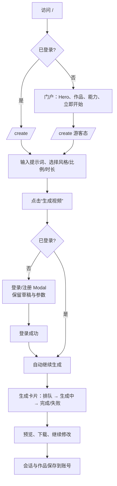

# AI Video Studio UI 设计规范

> 版本：v1.0  
> 日期：2026-10-27  
> 范围：PC Web 优先，移动端自适应；本文件是设计规范，不包含代码实现。  
> 设计方向：混合式入口（门户 + 对话工作台）+ 暗色影像工作室（Nocturne）。

## 0. 一句话方案

首次访问先看到作品与能力，点击「立即开始创作」进入可输入的对话工作台；只有点击「生成视频」时才弹出登录。登录期间保留提示词和生成参数，登录成功后自动继续。已登录用户访问 `/` 直接进入 `/create`。

这个方案同时满足两种入口诉求：

- 门户负责说明产品是什么、能做出什么，解决首次访问的信任问题。
- 对话工作台负责创作，输入提示词即可开始，登录不打断创作。

## 1. 设计目标

### 1.1 用户任务

1. 在 30 秒内理解：这是一个用自然语言生成视频的创作工具。
2. 不注册也能写下第一段提示词，感受到「马上可以开始」。
3. 点击生成时完成登录，不丢失已经写好的内容。
4. 生成过程中知道当前状态，失败后能重试，完成后能预览和继续修改。
5. 再次回来时能找到历史会话和作品。

### 1.2 设计原则

| 原则 | 含义 | 具体表现 |
| --- | --- | --- |
| 先创作，后登录 | 登录是生成前的门槛，不是进入产品的门槛 | `/create` 公开；输入框始终可用；登录 Modal 覆盖在当前页 |
| 作品先行 | 用视频画面建立信任，不用功能列表堆砌 | 门户 Hero 右侧直接放作品；案例区优先于能力说明 |
| 一个主界面 | 对话页就是产品首页，不把用户带进后台式导航 | `/create` 承载输入、会话、分镜、生成和结果 |
| 状态透明 | 每个异步状态都有明确文案和下一步 | 排队、生成、完成、失败、离线、登录过期 |
| 界面退后，内容发光 | 暗色中性界面衬托视频与提示词 | 低饱和表面、少量暖色强调、无大面积紫色渐变 |

### 1.3 不做什么

- 不做「登录后才能看到产品」的独立登录页作为主入口。
- 不做以数据看板、任务表格为主的后台首页。
- 不在用户输入前弹登录框。
- 不展示假的生成进度、假的剩余时间或假的额度。
- P0 不做浅色主题、团队协作、支付与会员体系。
- 不把 v0 / Lovable 生成的 Tailwind 代码直接搬进当前 React + AntD 项目。

## 2. 信息架构与流程

### 2.1 路由

| 路径 | 访问 | 页面 | 说明 |
| --- | --- | --- | --- |
| `/` | 公开 | Landing 门户 | 已登录访问时重定向到 `/create` |
| `/create` | 公开 | 对话创作工作台 | 游客可输入和选参数；生成时登录 |
| `/works` | 登录 | 我的作品 | 原 `/project` 的产品化版本；游客访问时回到 `/create` 并打开登录 |
| `/login` | 公开 | 登录页 | 保留为直接链接、邮件或异常兜底；常规流程使用 Modal |
| `/register` | 公开 | 注册页 | 同上 |
| `/settings` | 登录 | 账号设置 | P1，不在本期设计范围 |
| `*` | 公开 | 404 | 提供返回 `/` 的入口 |

兼容处理：

- `/chat` 重定向到 `/create`。
- `/project` 重定向到 `/works`。
- 旧的 `/login`、`/register` 页面保留，但不再是从门户进入的主路径。

### 2.2 主流程



### 2.3 游客与登录用户

| 能力 | 游客 | 登录用户 |
| --- | --- | --- |
| 浏览门户、案例 | 可以 | 可以 |
| 进入 `/create`、输入提示词 | 可以 | 可以 |
| 选择风格、比例、时长 | 可以（本地状态） | 可以 |
| 创建后端会话 | 不可以 | 可以 |
| 发送消息给 Agent | 不可以 | 可以 |
| 生成视频 | 点击后先登录 | 可以 |
| 查看历史会话 | 不可以 | 可以 |
| 查看作品、下载结果 | 不可以 | 可以 |

游客阶段的草稿只保存在本地，不创建后端会话。这样既避免匿名数据，也让「登录后继续」有明确含义。

### 2.4 登录闸门规则

登录闸门只在以下动作触发：

1. 游客点击「生成视频」。
2. 游客点击「我的作品」。
3. 会话过期或刷新 token 失败，且当前页面需要保存内容。
4. 游客点击顶栏「登录」。

不触发登录闸门的动作：

- 打开 `/create`。
- 输入、修改、删除提示词。
- 切换风格、比例、时长。
- 展开示例提示词。
- 关闭页面或返回门户。

闸门行为：

- 打开 Modal，不跳转页面。
- 输入框和参数保持原值，不清空。
- Modal 内展示一行草稿摘要，让用户确认内容还在。
- 登录或注册成功后，Modal 关闭，自动提交刚才的生成请求。
- 登录失败时，Modal 保持打开，显示行内错误，草稿不变。
- 用户关闭 Modal，回到工作台，草稿仍在。
- 草稿写入 `sessionStorage`，刷新页面后仍可恢复，默认保留 24 小时。

## 3. 页面规范

### 3.1 门户 `/`

#### 桌面结构（1440 宽）

| 区域 | 高度/尺寸 | 内容 |
| --- | --- | --- |
| 顶部导航 | 72px，最大宽 1280 | 标志、作品/能力/工作流、登录、立即开始创作 |
| Hero | 内容自适应，建议最小 640px | 左侧主张与 CTA，右侧 16:9 作品展示 |
| 创作步骤 | 约 360px | 三步流程：描述画面 → 生成分镜 → 生成视频 |
| 作品案例 | 约 640px | 3 列 × 2 行，16:9 缩略图 |
| 能力说明 | 约 360px | 文生视频、分镜、风格控制、结果管理 |
| 结尾 CTA | 约 280px | 一句行动文案 + 主按钮 |
| Footer | 约 120px | 品牌、文档、状态、版权 |

#### Hero

- 左侧最大宽度 620px。
- 眉题：`AI VIDEO STUDIO / 01`
- 主标题：`把一句话，变成一支片。`
- 副标题：`描述画面、节奏与情绪。AI 帮你整理分镜、生成视频。先写下来，剩下的交给工作室。`
- 主按钮：`立即开始创作`（48px 高，暖色实心）
- 次按钮：`看 30 秒示例`（48px 高，描边）
- 辅助信息：`无需安装 · 浏览器内创作 · 当前为能力演示`
- 右侧：16:9 作品框，圆角 24px，包含一张真实影像风格的封面、播放控制、底部提示词浮层、右下角时长标签。
- 不在首屏使用自动播放声音；默认静音循环，提供暂停。
- 不用大面积紫色渐变或抽象光球代替作品画面。

#### 作品案例

- 3 列网格，间距 16px。
- 每张卡片 16:9，封面占主导；标题 15px，元信息 12px。
- 悬停时封面轻微放大 1.01，出现播放图标；不做整卡上浮和重阴影。
- 案例必须有真实内容或明确标注为示例，不使用「Lorem ipsum」或无意义占位文案。
- P0 可先使用 6 张授权影像封面；没有素材时使用带片名和参数的渐变占位，但不能伪装成真实作品。

#### 移动端

- 导航 56px，只保留标志、登录、菜单。
- Hero 单列：标题 38/44，作品框放在文案之后。
- 按钮整行宽，主按钮在上。
- 案例改为横向滚动，卡片宽度 78vw，内部滚动不影响页面横向宽度。
- 结尾 CTA 与 Footer 保持单列。

### 3.2 对话工作台 `/create`

#### 桌面结构

| 区域 | 尺寸 | 说明 |
| --- | --- | --- |
| 左侧栏 | 280px，固定 | 品牌、新建创作、会话历史、用户/登录 |
| 顶栏 | 64px，固定 | 当前会话标题、连接状态、帮助、用户/登录 |
| 对话区 | 自适应，内容最大 760px | 消息、分镜卡、生成卡 |
| 输入区 | 底部固定，最大 880px | 提示词、参数、生成按钮 |

#### 左侧栏

- 顶部：品牌标志 + 新建创作按钮（40px 高，整行）。
- 搜索：P1；P0 不显示无法使用的搜索框。
- 历史会话分组：`今天`、`近 7 天`、`更早`。
- 会话项：64px 高，12px 圆角，包含标题、时间、当前状态点；激活项使用 `surface-raised`，不使用左侧彩色竖条。
- 游客态：历史区替换为一张说明卡：
  - 标题：`登录后保存创作`
  - 正文：`你的会话、分镜和生成结果会出现在这里。`
  - 按钮：`登录 / 注册`
- 底部：用户菜单或登录按钮；`Mock 模式` 徽标只在开发阶段显示。

#### 顶栏

- 左侧：当前会话标题，过长时省略；新建状态下显示 `新创作`。
- 右侧：实时连接状态、帮助入口、用户头像或登录按钮。
- 连接状态不使用纯颜色圆点，必须有文字：`实时连接` / `离线兜底`。
- 不显示未实现的额度、会员、团队空间。

#### 空状态

- 内容最大宽度 880px，距离顶部约 14vh，不撑满整屏。
- 眉题：`NEW CREATION`
- 标题：`今天想拍什么？`
- 说明：`写下一个画面，AI 会帮你整理镜头、节奏和生成参数。`
- 输入框：880px 宽，最小 144px 高，20px 圆角。
- 示例提示词：4 个横向标签，可点击填入输入框。
- 参数行：`风格`、`比例`、`时长`；P0 可使用默认值，接口未支持前不要假装已经生效。
- 输入区底部：`Enter 生成 · Shift + Enter 换行`。
- 主按钮：`生成视频`。

#### 对话进行中

- 用户消息：右对齐，最大宽度 72%，暖色表面，14px 圆角；不使用高饱和气泡。
- 助手消息：左对齐，头像 32px，正文不使用厚气泡，保持阅读感；宽度与内容区一致。
- 助手名称：`AI 导演`。
- 流式输出：末尾 1px 光标闪烁；不要用「正在输入…」反复跳动。
- 分镜卡：助手回复后出现，包含镜头摘要、风格、比例、时长和主按钮 `生成视频`。
- 生成卡：16:9 预览区 + 状态行 + 进度条 + 操作。
- 输入区在对话中固定在底部，上方用 48px 渐变遮罩过渡。

#### 生成卡状态

| 状态 | 文案 | 视觉 | 主操作 |
| --- | --- | --- | --- |
| 排队 | `已进入队列` | 中性徽标，静态封面 | 取消（P1） |
| 准备 | `正在准备画面` | 进度 0–29%，轻微呼吸 | 无 |
| 生成 | `正在生成画面` | 进度 30–69%，封面微光 | 离开页面不中断 |
| 收尾 | `正在合成结果` | 进度 70–99% | 无 |
| 完成 | `视频已生成` | 播放器 + 成功徽标 | 预览、下载、继续修改 |
| 失败 | `生成没有完成` | 错误徽标 + 原因 | 重试、修改提示词 |
| 离线 | `实时连接中断，结果仍会保存` | 顶栏状态 + 生成卡提示 | 自动重连 |

进度文案严格映射后端进度，不编造阶段。当前占位服务只会跳到 30、70、100，界面按区间显示即可。

#### 游客态

- 输入框可用，按钮文案为 `生成视频`。
- 点击生成后打开登录 Modal。
- 左侧栏显示登录说明卡。
- 顶栏右侧显示 `登录`。
- 不请求会话列表，不建立 WebSocket。
- 登录成功后自动创建会话并继续，不清空草稿。

#### 移动端

- 顶栏 56px：菜单、当前标题、登录/头像。
- 左侧栏改为 300px 抽屉，打开时背景压暗，Esc/点击遮罩关闭。
- 对话区左右 16px，消息不留大边距。
- 输入区固定在底部，使用 `env(safe-area-inset-bottom)`；文本域 2–4 行。
- 参数改为横向滚动标签，不换行挤压。
- 登录 Modal 改为底部抽屉，顶部有 36×4 的拖拽条。
- 生成卡宽度 100%，操作按钮换行，不出现横向滚动。

### 3.3 我的作品 `/works`

- 页面标题：`我的作品`。
- 说明：`所有生成中的任务和已完成视频，都保存在这里。`
- 筛选：`全部`、`生成中`、`已完成`、`失败`。
- 网格：桌面 3 列、平板 2 列、手机 1 列；16:9 封面优先。
- 卡片信息：状态、提示词前两行、风格/比例/时长、更新时间。
- 生成中的卡片显示进度条；完成后显示播放按钮。
- 空状态：`还没有作品。先写下第一个画面。` + `开始创作`。
- 错误状态：`作品加载失败。` + `重试`。
- 不使用后台表格；不做任务 ID 主视觉。

### 3.4 登录 / 注册 Modal

#### 桌面

- 宽度 440px，圆角 20px，内边距 32px。
- 背景遮罩：`rgba(0, 0, 0, 0.64)` + 8px 模糊。
- 顶部：品牌标志、关闭按钮。
- 标题（生成闸门）：`登录后继续生成`
- 说明：`提示词和参数已经保留。登录或注册后会自动继续。`
- 草稿摘要：一行提示词 + `已保留` 徽标；过长省略，悬停可看全文（P1）。
- 登录/注册切换：文字式分段控件，不做厚重 Tab。
- 登录字段：账号、密码。
- 注册字段：用户名、邮箱、密码；昵称可选，P1。
- 主按钮：`登录并继续` / `注册并继续`；登录页兜底时为 `登录`。
- 辅助文案：`还没有账号？注册` / `已有账号？登录`。
- 法律文案：`继续即表示你同意服务条款和隐私政策。` 仅在对应页面存在时加链接，不能放空链接。
- 不做「忘记密码」假入口；后端未实现前不展示。

#### 状态

| 状态 | 表现 |
| --- | --- |
| 默认 | 表单可编辑，主按钮可用 |
| 提交中 | 按钮 loading，字段只读，关闭按钮仍可用 |
| 字段错误 | 字段下方 12px 错误文案，不用全局 Toast |
| 账号或密码错误 | 表单顶部行内错误：`账号或密码不正确，请重新输入。` |
| 网络失败 | 行内错误：`网络连接失败，请检查网络后重试。` |
| 成功 | 按钮变为 `登录成功，正在继续…`，200ms 后关闭并继续生成 |
| 注册成功 | 与登录成功一致，直接进入工作台 |

#### 移动端

- 底部抽屉，圆角 20px 20px 0 0，最大高度 88vh。
- 顶部拖拽条 36×4。
- 输入框 48px 高，按钮整行。
- 键盘弹起时，主按钮保持可见；表单项可滚动。

### 3.5 其他状态

| 场景 | 设计 |
| --- | --- |
| 页面加载 | 结构骨架，不用全屏 spinner |
| 会话加载 | 左侧会话项骨架 + 对话区轻量占位 |
| 空会话 | 引导输入，不显示空白画布 |
| WebSocket 断开 | 顶栏 `离线兜底`，生成仍可轮询；恢复后自动切回 |
| 登录过期 | 保留草稿，打开登录 Modal；登录后继续原动作 |
| 生成失败 | 卡片内说明原因，提供 `重试` 和 `修改提示词` |
| 404 | `这个页面不存在。` + `回到首页` |
| 网络错误 | 行内说明 + 重试，不使用只有「出错了」的 Toast |

## 4. 视觉系统

### 4.1 方向：Nocturne / 夜场

暗色影像工作室，不是「深色后台」。界面像一间关灯后的剪辑室：大面积碳黑，暖白文字，钨丝灯色的行动点，少量青色用于技术状态。视频和画面是唯一的高饱和内容，UI 不抢戏。

关键词：

- 电影片场、剪辑台、放映厅。
- 暖钨丝光 + 冷暗部。
- 大画面、少边框、精确的间距。
- 衬线标题只在门户和品牌语境使用；工作台使用无衬线，保证效率。
- 不使用紫色到蓝色的渐变、玻璃拟态堆叠、发光球体、机器人插画。

### 4.2 颜色 Token

| Token | 值 | 用途 |
| --- | --- | --- |
| `color/bg` | `#0B0D10` | 页面底色 |
| `color/surface` | `#12151A` | 侧栏、输入区、卡片基础表面 |
| `color/surface-raised` | `#191D24` | 激活项、浮层、Modal |
| `color/line` | `#272C35` | 分隔线、输入边框 |
| `color/text` | `#F2EEE6` | 主要文字、暖白 |
| `color/text-secondary` | `#A7ADB7` | 次要文字 |
| `color/text-tertiary` | `#8A919C` | 辅助信息、时间 |
| `color/accent` | `#F2B35C` | 主按钮、焦点、关键强调 |
| `color/accent-hover` | `#FFC978` | 主按钮悬停 |
| `color/accent-ink` | `#1A1206` | 暖色按钮上的文字 |
| `color/halide` | `#75D8D2` | 连接、技术状态、次要强调 |
| `color/success` | `#66D19E` | 完成 |
| `color/warning` | `#F2B35C` | 排队、提醒 |
| `color/danger` | `#FF746C` | 失败、错误 |
| `color/focus` | `rgba(242, 179, 92, 0.38)` | 焦点外圈 |

使用比例：

- 70% 碳黑与表面。
- 20% 暖白文字与中性线。
- 8% 暖色行动点。
- 2% 青色/语义色。

对比度目标：

- 正文与背景 ≥ 4.5:1。
- 大字号标题 ≥ 3:1。
- 不依赖颜色单独传达状态；状态必须有文字或图标。
- 12px 辅助文字使用 `text-tertiary` 时需在设计工具中检查，不达标就加深。

### 4.3 字体

| 角色 | 字体 | 字号/行高 | 字重 | 用途 |
| --- | --- | --- | --- | --- |
| Display | Noto Serif SC | 64/68 | 600 | 门户 Hero |
| Display mobile | Noto Serif SC | 38/44 | 600 | 移动门户 |
| H1 | Noto Sans SC | 40/48 | 600 | 页面标题 |
| H2 | Noto Sans SC | 28/36 | 600 | 区块标题 |
| H3 | Noto Sans SC | 20/28 | 600 | 卡片标题 |
| Body | Noto Sans SC | 15/24 | 400 | 正文、消息 |
| Body strong | Noto Sans SC | 15/24 | 500 | 强调 |
| Label | Noto Sans SC | 13/20 | 500 | 表单、按钮 |
| Caption | Noto Sans SC | 12/18 | 400 | 时间、辅助信息 |
| Mono | IBM Plex Mono | 11/16 | 400/500 | 眉题、编号、参数 |

规则：

- 中文正文不使用全大写英文标签混排；眉题可以全大写，但增加 0.12em 字距。
- 数字列使用 `font-variant-numeric: tabular-nums`。
- 标题使用 `text-wrap: balance`，正文控制在约 65 个字符宽。
- P0 不加载过多字重；Noto Serif SC 600、Noto Sans SC 400/500/600、IBM Plex Mono 400/500 足够。
- 系统字体回退：`"PingFang SC", "Hiragino Sans GB", "Microsoft YaHei", sans-serif`。

### 4.4 间距与栅格

| Token | 值 |
| --- | --- |
| `space/1` | 4px |
| `space/2` | 8px |
| `space/3` | 12px |
| `space/4` | 16px |
| `space/5` | 20px |
| `space/6` | 24px |
| `space/8` | 32px |
| `space/10` | 40px |
| `space/12` | 48px |
| `space/16` | 64px |
| `space/20` | 80px |
| `space/24` | 96px |

- 页面最大宽度：1280px。
- 对话内容最大宽度：760px。
- 输入区最大宽度：880px。
- 12 列栅格，列间距 24px。
- 页面左右内边距：桌面 48px，平板 24px，手机 16px。
- 区块垂直间距：桌面 96px，平板 64px，手机 48px。
- 组件内边距：卡片 20–24px，Modal 32px，输入区 20px。

### 4.5 圆角、边框与阴影

| 角色 | 圆角 | 说明 |
| --- | --- | --- |
| 标签/徽标 | 6px | 小型状态 |
| 按钮/输入 | 10px | 常规控件 |
| 卡片 | 14px | 作品卡、分镜卡 |
| 输入区/Modal | 20px | 大面积容器 |
| 胶囊 | 999px | 参数标签、头像 |

- 卡片优先使用 `1px` 边框和表面色区分，不默认加阴影。
- 只有输入区、Modal、浮层使用阴影：
  - `shadow/float: 0 24px 80px rgba(0, 0, 0, 0.55)`。
  - `shadow/modal: 0 32px 120px rgba(0, 0, 0, 0.65)`。
- 焦点环：`0 0 0 2px #0B0D10, 0 0 0 4px rgba(242, 179, 92, 0.75)`。

### 4.6 动效

| 场景 | 时长 | 缓动 | 说明 |
| --- | --- | --- | --- |
| 悬停/颜色变化 | 120ms | ease-out | 只改变颜色或透明度 |
| 按钮/状态切换 | 200ms | `cubic-bezier(.22,1,.36,1)` | 不弹跳 |
| Modal 进入 | 240ms | 同上 | 背景淡入，面板从 0.98 到 1 |
| 页面首屏 | 480ms | 同上 | 文案和画面错开 60ms，向上 12px |
| 生成进度 | 400ms | ease-out | 只过渡宽度，不做无限假动画 |
| 流式光标 | 1s | step-end | 闪烁 |

- 支持 `prefers-reduced-motion: reduce`：关闭位移、缩放和闪烁。
- 不使用视差、自动轮播、持续漂浮粒子。
- 成功状态不做彩带或全屏庆祝。

### 4.7 图像与图标

- 图标：24px 线性图标，1.5px 描边；实现使用 Ant Design Icons，设计稿不要混用三套图标。
- 标志：28×28 圆角方形，四角取景框 + 中心暖色点；避免通用播放三角。
- 作品封面：16:9 真实影像或明确标注的占位封面。
- 头像：32px 圆形；没有头像时使用首字母或几何图形，不使用随机人物照片。
- 背景纹理：极轻的胶片颗粒或细网格，透明度低于 4%，不影响文字。
- 不使用 emoji 作为区块标记。

### 4.8 Ant Design Token 映射

| AntD Token | 值 |
| --- | --- |
| `colorPrimary` | `#F2B35C` |
| `colorInfo` | `#75D8D2` |
| `colorSuccess` | `#66D19E` |
| `colorWarning` | `#F2B35C` |
| `colorError` | `#FF746C` |
| `colorBgBase` | `#0B0D10` |
| `colorBgContainer` | `#12151A` |
| `colorBgElevated` | `#191D24` |
| `colorBorder` | `#272C35` |
| `colorText` | `#F2EEE6` |
| `colorTextSecondary` | `#A7ADB7` |
| `borderRadius` | `10` |
| `borderRadiusLG` | `20` |
| `controlHeight` | `40` |
| `controlHeightLG` | `48` |
| `fontFamily` | `"Noto Sans SC", "PingFang SC", "Microsoft YaHei", sans-serif` |

实现时：

- `ConfigProvider` 使用 `theme.algorithm = theme.darkAlgorithm`。
- 在 `src/index.css` 中定义同名 CSS 变量，组件样式引用变量，不写死颜色。
- 主按钮使用暖色底 + 深色文字；不要用白字配暖黄，避免对比不足。
- Modal、Input、Tooltip 的深色样式统一在主题层解决，不在页面里逐个覆盖。

## 5. 组件清单

### 5.1 组件列表

| 组件 | 优先级 | 状态/变体 | 说明 |
| --- | --- | --- | --- |
| `BrandMark` | P0 | 默认/小号 | 取景框标志 + 文字 |
| `LandingHeader` | P0 | 游客/已登录 | 门户顶栏 |
| `Hero` | P0 | 桌面/移动 | 标题、CTA、作品框 |
| `Showreel` | P0 | 播放/暂停/加载 | 16:9 作品展示 |
| `ExampleGallery` | P0 | 默认/空 | 作品案例网格 |
| `ExamplePromptChip` | P0 | 默认/悬停 | 点击填入提示词 |
| `PromptComposer` | P0 | 空/有内容/生成中/错误/游客 | 提示词、参数、主按钮 |
| `ComposerParams` | P0 | 默认/展开 | 风格、比例、时长 |
| `AuthModal` | P0 | 登录/注册/提交/错误/成功 | 同页登录闸门 |
| `DraftSummary` | P0 | 单行/折叠 | 展示已保留草稿 |
| `WorkspaceSidebar` | P0 | 游客/登录/加载/空 | 会话历史 |
| `SessionItem` | P0 | 默认/激活/悬停 | 会话项 |
| `WorkspaceTopBar` | P0 | 游客/登录/离线 | 标题与状态 |
| `MessageThread` | P0 | 空/加载/流式 | 消息列表 |
| `MessageBubble` | P0 | 用户/助手/流式 | 用户气泡与助手正文 |
| `StoryboardCard` | P0 | 默认/生成中 | 镜头摘要与生成入口 |
| `GenerationCard` | P0 | 排队/准备/生成/收尾/完成/失败/离线 | 视频任务卡 |
| `WorkCard` | P0 | 生成中/完成/失败 | 作品网格卡 |
| `EmptyState` | P0 | 通用 | 标题、说明、主操作 |
| `SocketBadge` | P0 | 在线/离线 | 文字 + 图标，不只用颜色 |
| `UserMenu` | P0 | 游客/登录 | 登录按钮或头像菜单 |
| `MobileDrawer` | P0 | 关闭/打开 | 移动端侧栏 |
| `Toast` | P0 | 成功/错误/信息 | 短反馈，不承载关键错误 |
| `Skeleton` | P0 | 文本/卡片/列表 | 加载占位 |
| `CreditsBadge` | 不做 | — | 后端无额度能力，不展示 |

### 5.2 关键组件规格

#### PromptComposer

- 容器：最大 880px，宽 100%，内边距 20px，圆角 20px，背景 `surface`，边框 `line`。
- 文本域：15/24，最小 2 行，最大 6 行，无内边框，聚焦时容器显示暖色焦点环。
- 参数行：左侧标签，右侧 `生成视频` 按钮；空间不足时标签换行，按钮不缩小到 44px 以下。
- 按钮：高 44px，圆角 10px，暖色实心，深色文字；生成中显示 loading 并禁用重复提交。
- 游客态：按钮文案仍为 `生成视频`；不显示「登录后可用」的禁用态，因为点击后应打开登录，而不是让用户无处可点。
- 错误态：容器保持焦点，错误文案在容器下方 8px，不替换用户内容。
- 字数：超过 2000 字显示计数；接近上限时提示，不静默截断。

#### AuthModal

- 桌面 440px；移动端底部抽屉。
- 结构：品牌/关闭 → 标题 → 说明 → 草稿摘要 → 分段切换 → 表单 → 主按钮 → 辅助链接 → 法律文案。
- 表单标签在输入框上方，13px；不使用 placeholder 代替标签。
- 错误在字段下方或表单顶部，不使用 Toast 作为唯一反馈。
- 提交中锁定表单，但保留关闭能力；关闭即取消本次登录，草稿不变。
- 成功文案停留 200ms，避免闪烁。

#### GenerationCard

- 宽度：内容区 100%，最大 560px。
- 预览：16:9，圆角 14px；生成中使用封面 + 轻扫光，不使用无限旋转 spinner 作为主视觉。
- 状态行：状态徽标 + 文案 + 进度百分比。
- 进度条：4px 高，暖色；完成后变成功色。
- 操作：完成时 `预览`、`下载`、`继续修改`；失败时 `重试`、`修改提示词`。
- 下载在 P0 可指向占位结果；必须标注「示例结果」，不能伪装成真实视频。

#### WorkspaceSidebar

- 宽度 280px，背景 `surface`，右边框 `line`。
- 顶部 24px 内边距；会话列表可滚动，底部固定用户区。
- 会话标题单行省略，时间 12px；不在列表里放长提示词。
- 激活项只改变表面色和文字色，不加左侧彩条。
- 游客态说明卡不使用大插画，保持信息密度。

#### MessageBubble

- 用户：右对齐，最大 72%，背景 `surface-raised`，圆角 14px，内边距 12px 16px。
- 助手：左对齐，头像 32px，正文最大 760px，不使用重气泡；段落间距 12px。
- 元信息：名称 13px，时间 12px；工具标签使用中性描边，不使用高饱和紫色。
- 流式光标：1px × 1em，暖色，`prefers-reduced-motion` 时改为静态省略号。

### 5.3 状态矩阵

| 场景 | 输入区 | 主按钮 | 侧栏 | 顶栏 | 反馈 |
| --- | --- | --- | --- | --- | --- |
| 游客空 | 可用 | 生成视频 | 登录说明卡 | 登录 | 示例提示词 |
| 游客有草稿 | 可用 | 生成视频 | 登录说明卡 | 登录 | 草稿本地保存 |
| 登录 Modal | 背景锁定 | — | 背景压暗 | 不变 | 草稿摘要 |
| 登录提交 | 字段只读 | loading | 不变 | 不变 | 行内状态 |
| 生成中 | 可用新输入（P1） | 禁用 | 会话更新 | 连接状态 | 生成卡 |
| 生成完成 | 可用 | 生成视频 | 会话更新 | 连接状态 | 播放器 |
| 生成失败 | 可用 | 重试 | 会话保留 | 连接状态 | 原因 + 重试 |
| 离线 | 可用 | 可用 | 保留 | 离线兜底 | 结果仍保存 |
| 登录过期 | 保留草稿 | 触发登录 | 保留 | 登录 | 登录 Modal |

## 6. 文案规范

### 6.1 语气

- 直接、具体、像一位懂制作的同事。
- 用主动语态，按钮说明结果：`生成视频`，不是 `提交`。
- 错误说明发生了什么、怎么恢复，不道歉，不卖萌。
- 不用「一键」「魔法」「赋能」「颠覆」「未来已来」。
- 不用感叹号堆情绪；不用 emoji 代替图标。

### 6.2 核心文案

| 位置 | 文案 |
| --- | --- |
| 门户眉题 | `AI VIDEO STUDIO / 01` |
| 门户主标题 | `把一句话，变成一支片。` |
| 门户副标题 | `描述画面、节奏与情绪。AI 帮你整理分镜、生成视频。先写下来，剩下的交给工作室。` |
| 主 CTA | `立即开始创作` |
| 次 CTA | `看 30 秒示例` |
| 门户辅助 | `无需安装 · 浏览器内创作 · 当前为能力演示` |
| 工作台标题 | `今天想拍什么？` |
| 工作台说明 | `写下一个画面，AI 会帮你整理镜头、节奏和生成参数。` |
| 输入占位 | `描述你想拍的画面，例如：傍晚的海边，浪花慢镜头，暖色调，镜头缓慢推进…` |
| 主按钮 | `生成视频` |
| 输入提示 | `Enter 生成 · Shift + Enter 换行` |
| 示例 1 | `雨夜霓虹街头，慢推镜头，电影感` |
| 示例 2 | `清晨雾中的森林，航拍，冷色调` |
| 示例 3 | `咖啡杯特写，暖光，胶片质感` |
| 示例 4 | `产品旋转展示，纯色背景，干净光线` |
| 登录标题 | `登录后继续生成` |
| 登录说明 | `提示词和参数已经保留。登录或注册后会自动继续。` |
| 草稿徽标 | `已保留` |
| 登录按钮 | `登录并继续` |
| 注册按钮 | `注册并继续` |
| 游客侧栏 | `登录后保存创作` |
| 游客侧栏说明 | `你的会话、分镜和生成结果会出现在这里。` |
| 作品标题 | `我的作品` |
| 作品空状态 | `还没有作品。先写下第一个画面。` |
| 排队 | `已进入队列` |
| 准备 | `正在准备画面` |
| 生成 | `正在生成画面` |
| 收尾 | `正在合成结果` |
| 完成 | `视频已生成` |
| 失败 | `生成没有完成` |
| 失败说明 | `你可以重试，提示词和参数还在。` |
| 离线 | `实时连接中断，结果仍会保存。` |
| 登录过期 | `登录已过期。重新登录后会继续当前操作。` |

### 6.3 错误文案

| 场景 | 文案 |
| --- | --- |
| 账号或密码错误 | `账号或密码不正确，请重新输入。` |
| 用户名已存在 | `这个用户名已被使用，换一个试试。` |
| 邮箱已存在 | `这个邮箱已经注册过，直接登录即可。` |
| 网络失败 | `网络连接失败，请检查网络后重试。` |
| 生成失败 | `生成没有完成。你可以重试，提示词和参数还在。` |
| 作品加载失败 | `作品加载失败。` + `重试` |
| 会话加载失败 | `会话没有加载出来。` + `重试` |
| 404 | `这个页面不存在。` + `回到首页` |

## 7. 可访问性

- 正文对比度 ≥ 4.5:1；大字号 ≥ 3:1。
- 所有图标按钮有 `aria-label`；图标不单独承载语义。
- 焦点可见：暖色双环，不能只依赖浏览器默认轮廓。
- Modal 打开时焦点进入第一个输入框，焦点陷阱；Esc 关闭；关闭后焦点回到触发按钮。
- 生成状态使用 `aria-live="polite"` 播报；进度条提供 `aria-valuenow`。
- 键盘：Tab 顺序与视觉顺序一致；Enter 生成，Shift + Enter 换行；中文输入法组合状态不触发提交。
- 视频提供播放/暂停、静音、字幕（有对白时）；门户展示视频默认静音。
- 触控目标不小于 44×44px。
- 支持 `prefers-reduced-motion`；流式光标、扫光、位移动画全部降级。
- 200% 文字缩放时，按钮和卡片不裁切；长提示词换行，不溢出。

## 8. Figma 执行指引

### 8.1 工具选择

| 用途 | 建议 |
| --- | --- |
| 高保真设计、组件、原型 | Figma（首选） |
| 国内协作/交付 | MasterGo、即时设计、Pixso |
| 开源/自托管 | Penpot |
| AI 生成初稿 | Figma Make / First Draft、v0、Lovable |
| 动效演示 | Rive、LottieFiles；P0 不需要 |

AI 生成结果只作为构图参考。最终界面按本规范的 token 和组件重建，不直接复用生成的 Tailwind 代码。

### 8.2 Figma 文件结构

```text
AI Video Studio / Design
├── 00 Cover
├── 01 Foundations
│   ├── Color
│   ├── Type
│   ├── Spacing & Grid
│   ├── Radius & Shadow
│   └── Motion
├── 02 Components
│   ├── Buttons
│   ├── Inputs
│   ├── Auth
│   ├── Navigation
│   ├── Conversation
│   ├── Generation
│   └── Feedback
├── 03 Landing
│   ├── Desktop 1440
│   ├── Tablet 1024
│   └── Mobile 390
├── 04 Create
│   ├── Guest Empty
│   ├── Guest Filled
│   ├── Auth Modal
│   ├── Logged In
│   ├── Generating
│   └── Success / Failed
├── 05 Works
├── 06 Responsive
└── 07 Prototype
```

帧命名：

```text
03 / Landing / Desktop
04 / Create / Guest Filled / Desktop
04 / Create / Auth Modal / Desktop
04 / Create / Generating / Mobile
05 / Works / Empty / Desktop
```

### 8.3 Variables 与样式

颜色集合：

```text
color/bg/base
color/bg/surface
color/bg/raised
color/border/subtle
color/text/primary
color/text/secondary
color/text/tertiary
color/accent/tungsten
color/accent/tungsten-hover
color/accent/ink
color/state/halide
color/state/success
color/state/danger
```

其他集合：

```text
space/1 … space/24
radius/tag, radius/control, radius/card, radius/panel, radius/pill
type/display, type/h1, type/h2, type/h3, type/body, type/label, type/caption, type/mono
```

规则：

- 颜色用 Variables，不用零散颜色样式。
- 文字用 Text Styles，命名与 `type/*` 一致。
- 阴影只建两个 Effect Style：`shadow/float`、`shadow/modal`。
- 组件内所有间距用 Auto Layout 和变量，不手动拖拽。
- 设计稿只做 Dark 模式；Light 模式不在 P0，不创建空变量模式。

### 8.4 组件与 Variants

| 组件 | Variants |
| --- | --- |
| `Button` | Type: Primary/Secondary/Ghost/Danger；Size: MD/LG；State: Default/Hover/Focus/Loading/Disabled |
| `PromptComposer` | State: Empty/Filled/Generating/Error；Audience: Guest/LoggedIn；Viewport: Desktop/Mobile |
| `GenerationCard` | Status: Queued/Preparing/Generating/Finishing/Success/Failed/Offline |
| `AuthModal` | Mode: Login/Register；State: Default/Submitting/Error/Success |
| `SessionItem` | State: Default/Hover/Active |
| `WorkCard` | Status: Generating/Success/Failed |
| `SocketBadge` | State: Online/Offline |
| `ExamplePromptChip` | State: Default/Hover/Focus |

Auto Layout：

- 页面：纵向，宽度固定 1440，左右 48，区块间距 96。
- 侧栏：固定 280，纵向，顶部/底部内边距 24。
- 对话内容：最大宽 760，水平居中，纵向 gap 24。
- 输入区：固定最大宽 880，纵向 gap 12，内边距 20。
- 生成卡：宽度填充，最大 560；封面 16:9，信息区纵向 gap 12。
- Modal：固定 440，纵向 gap 20，内边距 32；按钮宽度填充。
- 作品网格：3 列，gap 16，卡片宽度填充；平板 2 列，手机 1 列。

约束：

- 侧栏固定宽度，主区填充。
- 顶栏高度固定 64，内容垂直居中。
- 封面图填充容器，保持 16:9，不拉伸。
- 文字层使用 Hug/Fill，避免固定高度导致换行裁切。

### 8.5 原型连接

1. `Landing / 立即开始创作` → `Create / Guest Empty`。
2. `Landing / 登录` → `Auth Modal / Login`。
3. `Create / 输入提示词` → `Create / Guest Filled`。
4. `Create / 生成视频` → `Auth Modal / Login`（Overlay）。
5. `Auth Modal / 登录成功` → `Create / Generating`。
6. `Create / Generating` → `Create / Success`（延时 2s 或点击）。
7. `Create / Success` → `Create / Logged In`。
8. `Create / 侧栏` → `Works / Default`。
9. `Mobile / 菜单` → `Mobile / Drawer`。
10. `Mobile / 生成视频` → `Mobile / Auth Bottom Sheet`。

原型要求：

- Overlay 不使用整页跳转，保持背景可见。
- Modal 关闭后回到原输入状态。
- 生成中的原型要能看出进度变化，不用假无限旋转。
- 成功页提供 `继续修改`，回到对话输入。

### 8.6 可直接粘贴的 AI 设计提示词

> 用法：Figma Make / First Draft 或 v0 / Lovable 的生成框。英文提示词对生成工具更稳定。生成后按本规范重建组件，不直接复制代码。

#### 提示词 A：门户

```text
Design a desktop landing page for "AI Video Studio", a browser-based AI video creation studio. Canvas 1440×1024.

Art direction: dark cinematic editing room, not a SaaS dashboard. Near-black carbon background #0B0D10, warm bone text #F2EEE6, tungsten amber accent #F2B35C, halide teal secondary #75D8D2. Editorial Chinese serif display for the hero, clean Chinese sans for UI, IBM Plex Mono for small metadata. Restrained borders, almost no shadows, no purple-blue gradients, no glassmorphism, no floating glowing orbs, no robot illustrations.

Top navigation 72px high, max width 1280: crop-mark logo + "AI Video Studio", links 作品 / 能力 / 工作流, right side "登录" text button and "立即开始创作" amber button.

Hero: two columns. Left: eyebrow "AI VIDEO STUDIO / 01", huge headline "把一句话，变成一支片。", subcopy "描述画面、节奏与情绪。AI 帮你整理分镜、生成视频。先写下来，剩下的交给工作室。", two CTAs "立即开始创作" and "看 30 秒示例", small line "无需安装 · 浏览器内创作 · 当前为能力演示". Right: 16:9 showreel frame with a cinematic still, subtle grain, play control, bottom prompt overlay, duration chip.

Below hero: a three-step process "描述画面 → 整理分镜 → 生成视频"; a 3×2 gallery of 16:9 video works with Chinese titles and parameter metadata; a capabilities strip; a final CTA band; footer.

Use real Chinese copy, no lorem ipsum, no emoji. Keep 70% dark neutral, 20% warm white, 8% amber, 2% teal. Make the first frame feel complete without scrolling.
```

#### 提示词 B：对话工作台

```text
Design a desktop AI video creation workspace at 1440×1024, for the product "AI Video Studio".

Art direction: dark film studio, carbon #0B0D10 background, surface #12151A, warm bone text #F2EEE6, tungsten amber #F2B35C accent, halide teal #75D8D2 for technical status. Chinese sans UI, IBM Plex Mono metadata. No purple gradients, no glass cards everywhere, no emoji.

Layout: fixed left sidebar 280px, top bar 64px, central conversation max width 760px, bottom composer max width 880px.

Left sidebar: crop-mark logo, full-width "新建创作" button, history groups 今天 / 近 7 天, session rows with title and time. One session is active using a slightly raised surface, not a colored left rail. Bottom user menu.

Top bar: current session title "雨夜霓虹街头", status "实时连接", help icon, avatar.

Center: conversation with one user message "雨夜霓虹街头，慢推镜头，霓虹反射在积水里，电影感" and one assistant reply from "AI 导演" summarizing three shots. Below the reply, a storyboard card with 风格 电影感 / 比例 16:9 / 时长 5s and a primary "生成视频" button.

Below that, a generation card with a 16:9 cinematic poster, state "正在生成画面", progress 68%, and a 4px amber progress bar. The card has "离开页面不会中断" as a quiet note.

Bottom composer: textarea with the next prompt draft, parameter chips 风格 / 比例 / 时长, and a 44px amber "生成视频" button. Enter to generate, Shift+Enter for a new line.

Make the scene feel like a working tool, not a marketing page. Show realistic Chinese content. Use generous spacing and only one elevated element: the composer.
```

#### 提示词 C：登录 Modal + 移动端

```text
Design two frames for "AI Video Studio".

Frame 1: desktop 1440×1024, an auth modal over a blurred dark create workspace. Modal width 440px, radius 20, background #191D24, backdrop rgba(0,0,0,0.64) with 8px blur. Title "登录后继续生成", body "提示词和参数已经保留。登录或注册后会自动继续。", a one-line draft summary "雨夜霓虹街头，慢推镜头…" with an "已保留" chip. Text segmented switch 登录 / 注册. Login fields 账号 and 密码. Primary amber button "登录并继续". Secondary link "还没有账号？注册". Small legal line. Close button. No social login.

Frame 2: mobile 390×844, the create workspace. Top bar 56px with menu, title, avatar. Conversation messages full width with 16px side padding. Bottom composer fixed to the bottom with safe-area padding, 2-row textarea, horizontal parameter chips, round amber send button. Show a bottom sheet auth variant with a 36×4 drag handle, title "登录后继续生成", draft summary, and the same form.

Art direction: carbon #0B0D10, surface #12151A, raised #191D24, warm bone #F2EEE6, tungsten amber #F2B35C, halide teal #75D8D2. Chinese sans UI. No purple gradients, no emoji, no oversized illustration. Keep the modal and sheet calm and readable.
```

### 8.7 交付检查

- [ ] 所有颜色来自 Variables，没有游离色值。
- [ ] 所有文字使用 Text Styles，字号/行高与规范一致。
- [ ] 主要流程可在 Prototype 中走通：门户 → 工作台 → 登录 → 生成 → 完成。
- [ ] 游客态、登录态、错误态、空状态、加载态齐全。
- [ ] 桌面 1440、平板 1024、手机 390 三个宽度检查过。
- [ ] 输入框、按钮、状态徽标在 200% 文字缩放下不裁切。
- [ ] 所有图标同一套、24px、1.5px 描边。
- [ ] 作品封面为 16:9，且有明确来源或示例标注。
- [ ] 不包含未实现的额度、会员、社交登录、忘记密码入口。
- [ ] 交付给开发时标注 P0/P1，避免把 P1 控件做成可点击的假功能。

## 9. 与当前代码的映射

本轮只产出设计规范，不修改代码。以下是后续实现时需要动的文件和数据流。

### 9.1 路由调整

当前：

```text
/login, /register → 独立页
/ → /chat（受保护）
/chat（受保护）
/project（受保护）
```

目标：

```text
/            → Landing（公开；已登录重定向 /create）
/create      → Create（公开；游客可输入）
/works       → Works（受保护）
/login       → 登录兜底页（公开）
/register    → 注册兜底页（公开）
/chat        → Redirect /create
/project     → Redirect /works
```

实现要点：

- `ProtectedRoute` 只包 `/works`，不要包 `/` 和 `/create`。
- 门户的 `登录` 和生成闸门都打开 `AuthModal`，不跳转 `/login`。
- 已登录访问 `/` 时在路由层重定向，避免先渲染门户再跳转。
- 直接访问 `/login` / `/register` 仍可用，登录成功后回到 `/create`；如果带 `redirect` 参数，校验为站内路径后再跳转。

### 9.2 文件与组件

建议新增：

```text
src/pages/Landing/index.tsx
src/pages/Create/index.tsx          // 由 Chat 演进
src/pages/Works/index.tsx           // 由 Project 演进
src/components/landing/Hero.tsx
src/components/landing/Showreel.tsx
src/components/landing/ExampleGallery.tsx
src/components/auth/AuthModal.tsx
src/components/create/PromptComposer.tsx
src/components/create/GenerationCard.tsx
src/components/create/StoryboardCard.tsx
src/components/create/WorkspaceSidebar.tsx
src/components/create/WorkspaceTopBar.tsx
src/components/common/EmptyState.tsx
src/components/common/SocketBadge.tsx
src/layouts/LandingLayout.tsx
src/layouts/CreateLayout.tsx
src/layouts/WorksLayout.tsx
src/stores/draftStore.ts
src/hooks/useAuthGate.ts
```

调整现有：

- `layouts/AppLayout.tsx`：拆成门户、工作台、作品三种壳层，避免所有页面共用一个后台顶栏。
- `pages/Chat/index.tsx`：重命名为 `Create`，空状态、输入区、生成卡按本规范重做。
- `pages/Project/index.tsx`：去掉创建表单，改为作品网格；生成参数移到分镜卡/输入区。
- `components/chat/SessionList.tsx`：演进为 `WorkspaceSidebar`，增加游客态和分组。
- `components/chat/ChatInput.tsx`：演进为 `PromptComposer`，增加参数和 `生成视频` 主按钮。
- `components/chat/VideoCard.tsx`：演进为 `GenerationCard`，支持进度、成功、失败和重试。
- `pages/Login/index.tsx`、`Register/index.tsx`：保留为兜底页，表单样式与 `AuthModal` 共用。

### 9.3 状态与登录闸门

推荐增加一个轻量的 `useAuthGate` 或 `authGateStore`：

```ts
type AuthGateReason = 'generate' | 'works' | 'expired';

interface AuthGateState {
  open: boolean;
  mode: 'login' | 'register';
  reason: AuthGateReason | null;
  pendingPrompt: string | null;
  pendingParams: Record<string, unknown> | null;
  openGate: (payload: { reason: AuthGateReason; prompt?: string }) => void;
  closeGate: () => void;
  completeGate: () => Promise<void> | void;
}
```

约束：

- `completeGate` 在登录成功后执行一次，执行完清空 `pendingPrompt`，避免重复提交。
- 不要在 Modal 组件里直接调用生成接口；由页面订阅 `completeGate` 后继续。
- 游客阶段不调用 `loadSessions`，不建立 WebSocket；`useChatSocket` 增加 `enabled` 参数或只在有 token 时挂载。
- `AuthModal` 复用 `authStore.login/register`；登录成功后不强制刷新整页。
- 草稿写入 `sessionStorage`，键名建议 `aivideo.create.draft`；包含 `prompt`、`style`、`aspect`、`duration`、`updatedAt`。
- 生成成功后清除草稿；失败保留；用户手动清空时同步清除本地存储。

### 9.4 接口映射与限制

当前已有接口：

| 能力 | 接口 | 说明 |
| --- | --- | --- |
| 登录/注册 | `/auth/login`、`/auth/register` | 可直接复用 |
| 当前用户 | `/auth/me` | 用于顶栏用户信息 |
| 会话 | `/chat/sessions` | 游客不可调用 |
| 消息 | `/chat/messages` | 只接收 `sessionId`、`content`、`requestId` |
| 视频任务 | `/video/tasks` | 接收 `prompt`、`params`；可轮询列表 |
| 实时进度 | `/ws/chat` | 已有 `video.progress` 事件 |

P0 不改后端的编排方式：

1. 游客点击生成 → 登录 Modal。
2. 登录成功 → 创建会话 → 发送消息。
3. 助手返回 `videoIntent=true` 后，前端用同一段提示词和参数调用 `/video/tasks`。
4. 生成卡显示任务进度；通过轮询或 `video.progress` 更新。
5. 完成/失败后把任务状态写入作品页。

需要明确的限制：

- `/chat/messages` 已接收强类型 `VideoGenerationParams`，包含风格、比例、时长、分辨率、声音和水印；界面参数优先于模型工具参数。
- 会话消息与视频任务已通过 `chat_session_id` / `chat_message_id` 持久化关联，刷新后可以恢复 `PROMPT_PROPOSAL` 和 `VIDEO_CARD`。
- P1 建议增加 `creation` 聚合接口或在消息 `metadata` 中保存 `videoTaskId`，让会话与作品形成稳定关联。
- Mock 模式的视频结果使用示例地址并标注「示例结果」；Seedance 模式展示持久化后的真实视频。

### 9.5 分阶段

| 阶段 | 内容 |
| --- | --- |
| P0 | 门户、公开 `/create`、AuthModal、草稿保留、登录后继续、生成卡、作品页、暗色 token |
| P1 | 会话/任务关联、搜索历史、参数真正进入消息、下载、重试策略、移动端抽屉细节 |
| P2 | 浅色模式、团队协作、额度/会员、模板市场、作品分享页 |

### 9.6 实现验收

```text
[ ] 未登录访问 /create 可以直接输入，不跳登录页
[ ] 点击生成打开同页 Modal，提示词、风格、比例、时长不丢失
[ ] 登录成功后自动继续，不重复提交
[ ] 关闭 Modal 后草稿仍在；刷新后草稿仍可恢复
[ ] 已登录访问 / 直接进入 /create
[ ] 游客不会调用 /chat/sessions、不会建立 WebSocket
[ ] 生成卡按真实进度显示，不出现假阶段
[ ] 失败后可以重试，提示词和参数保留
[ ] 会话过期时保留草稿并重新打开登录
[ ] 作品页能区分生成中、完成、失败
[ ] 桌面 1440 / 平板 1024 / 手机 390 无横向溢出
[ ] 键盘可完成输入、提交、关闭 Modal；焦点可见
[ ] 对比度、200% 文字缩放、减少动效检查通过
```

## 10. 交付物

本轮交付：

1. 本设计规范：信息架构、页面结构、视觉 token、组件、文案、Figma 指引。
2. 可直接粘贴到 Figma Make / v0 / Lovable 的三段提示词。
3. 与当前前端代码的改造映射，供后续实现排期。

不包含：

- Figma 源文件（需在设计工具中按本规范搭建）。
- 真实视频素材、品牌摄影、字体授权文件。
- 代码改动与接口变更。

建议下一步：

1. 在 Figma 建立 `01 Foundations`，先落 Variables 和 Text Styles。
2. 搭 `PromptComposer`、`GenerationCard`、`AuthModal` 三个核心组件。
3. 串起「门户 → 工作台 → 登录 → 生成 → 完成」原型。
4. 用 390px 移动端检查输入区和底部抽屉。
5. 设计确认后再按第 9 节映射改代码。
